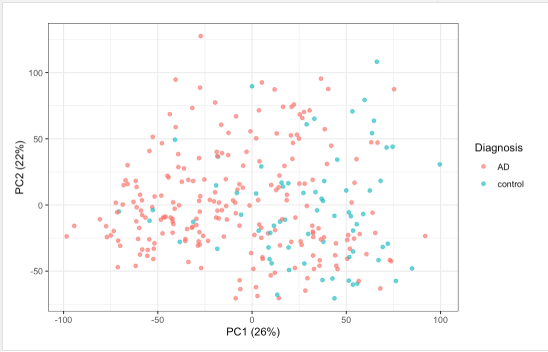
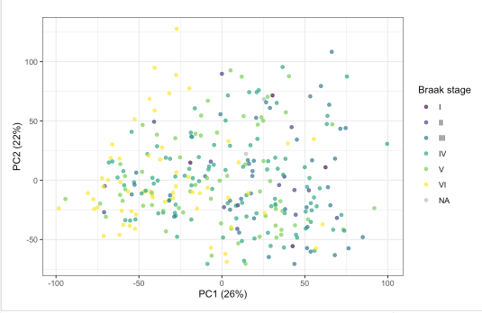

```{r setup, include=FALSE}
knitr::opts_chunk$set(echo = TRUE, warning = FALSE, message = FALSE)
```

------------------------------------------------------------------------

Write a short research paper (approximately 1500 words) using RMarkdown: Abstract, Introduction, Methods, Results, Discussion and References.

Hold a presentation (10 min) for the teachers highlighting your main findings. 

Data should be FAIR (ACRONYM)

------------------------------------------------------------------------

# Abstract
150 ord - spørsmål -> data -> metode -> hovedfunn -> betydning

# Introduction
~300 ord. Plan: AD → Braak → fusiform gyrus → kunnskapshull + spørsmål.
Unsupervised learning: (a) PCA/hierarchal clustering/heatmap to get an initial overview of the data, (b) network analysis and module detection, (c) GO enrichment analysis of modules, (d) pathway analysis of selected pathways. Work in groups of four.


## Research question

Are the gene co-expression modules associated with Braak stage in the fusiform gyrus the same as those associated with Alzheimer’s disease diagnosis, and what functions do they have?

# Methods
forteller hva vi gjorde, ingen resultater.

## Analysis overview

1.  **Filtering and normalization** (Lab 2): genes with ≥ 10 counts in ≥ 20 % of samples (58 of 289) kept → 21 487 genes; variance-stabilizing transformation (VST, DESeq2, `blind = TRUE`)
2.  **Overview** (Lab 4): PCA on all VST genes; hierarchical clustering of samples (Euclidean distance, complete linkage), coloured by diagnosis and Braak stage
3.  **Co-expression network** (Lab 6): signed WGCNA, soft-threshold power 20 (scale-free fit R² ≥ 0.80), `minModuleSize = 40`, `mergeCutHeight = 0.25` → 20 modules
4.  **Module–trait association** (Lab 6): module eigengenes vs. diagnosis (Pearson) and Braak stage I–VI (Spearman); linear models adjusted for age and sex; joint model testing Braak beyond diagnosis; Benjamini–Hochberg FDR
5.  **Functional enrichment** (Lab 3/7): GO biological processes and KEGG (clusterProfiler) for the pink, brown, magenta and green modules, all network genes as background; transcription-factor targets (Enrichr, ChEA 2022)
6.  **Differential expression** (Lab 3): DESeq2, design `~ age + sex + braak + diagnosis`; Wald test AD vs. control; likelihood-ratio test for Braak beyond diagnosis
7.  **Pathway analysis** (Lab 7): log2 fold changes (AD vs. control) on the KEGG glutamatergic synapse pathway (hsa04724), pathview
8.  **Hub genes** (Lab 6): top 10 genes by module membership (kME) per selected module, compared with the DESeq2 results

## Data

Gene expression data were obtained from the Gene Expression Omnibus (GEO; accession GSE125583) (Srinivasan et al. 2020). 

<<<<<<< HEAD
#koding
=======
The dataset contains bulk RNA-seq of post-mortem fusiform gyrus tissue from 219 patients with Alzheimer's disease (AD) and 70 age-matched, neurologically normal controls, sequenced on an Illumina HiSeq 2500. 

We used the raw count table generated by NCBI (reads aligned to GRCh38.p13; 39,376 genes). Diagnosis, age, sex and Braak stage (I–VI) were extracted from the GEO series matrix. Braak stage was missing for two samples, and age and sex for one sample each.

>>>>>>> 0b3a58edb57602e19b834c17eebf65d56033bae1
```{r, innlesing}
# Gentellinger: gener i rader og prøver i kolonner
counts <- read.delim(
  "data/GSE125583_raw_counts.tsv.gz",
  row.names = 1,
  check.names = FALSE
)

# Informasjon om hver prøve
traits <- read.csv(
  "data/GSE125583_traits.csv",
  stringsAsFactors = FALSE
)

# kontroll av innlesningene
dim(counts)
dim(traits)

counts[1:4, 1:4]
head(traits)
```

## Preprocessing

Genes with at least 10 counts in at least 20% of the samples (58 of 289) were kept, leaving 21,487 genes. 

Counts were normalized for library size and transformed with the variance-stabilizing transformation (VST) in DESeq2 (Love et al. 2014). 

Transformed data were explored with Principal Component Analysis (PCA) and hierarchical clustering of samples (Euclidean distance, complete linkage).

```{r, filtrere data}
# Minste antall prøver: 20 % av alle prøvene, rundet opp
min.samples <- ceiling(0.20 * ncol(counts))

# Behold gener med minst 10 tellinger i minst dette antallet prøver
keep <- rowSums(counts >= 10) >= min.samples
counts.filtered <- counts[keep, , drop = FALSE]

# Kontroller antall prøver som kreves og antall gener som beholdes
min.samples
nrow(counts.filtered)
```

```{r, normalisering}
library(DESeq2)

# Bruk prøve-ID-ene som radnavn i prøveinformasjonen
rownames(traits) <- traits$sample

# Samle gentellinger og prøveinformasjon i et DESeq2-objekt
dds <- DESeqDataSetFromMatrix(
  countData = as.matrix(counts.filtered),
  colData = traits,
  design = ~ 1
)

# Beregn normaliseringsfaktorer for prøvene
dds <- estimateSizeFactors(dds)

# VST-transformer og hent ut uttrykksmatrisen
vst <- varianceStabilizingTransformation(dds, blind = TRUE)
expr <- assay(vst)

dim(expr)
```

## Co-expression network analysis

A signed co-expression network was built from all 21,487 genes with WGCNA (Langfelder & Horvath 2008). The soft-thresholding power was set to 20, the lowest power giving a scale-free fit (R²) of at least 0.80. Modules were detected with `blockwiseModules` (maximum block size 5,000 genes, minimum module size 40, merge cut height 0.25).

## Module–trait association

Each module was summarized by its eigengene, the first principal component of its genes. Eigengenes were correlated with diagnosis (AD = 1, control = 0; Pearson) and Braak stage (coded 1–6; Spearman). Associations with diagnosis were also tested in linear models adjusted for age and sex. To separate pathology from clinical diagnosis, a joint model with diagnosis, Braak stage (as a factor), age and sex was compared with reduced models without Braak stage or without diagnosis using F-tests. P-values were adjusted with the Benjamini–Hochberg method, and FDR \< 0.05 was considered significant (Benjamini & Hochberg 1995).

## Functional enrichment

Four modules (pink, brown, magenta and green) were selected for functional analysis. <!-- TODO: add one sentence on WHY these four were chosen --> Enrichment of Gene Ontology biological processes and KEGG pathways was tested with clusterProfiler (Xu et al. 2024), with all network genes as background. Hub genes were defined as the ten genes with the highest module membership (kME), i.e. the strongest correlation with the module eigengene. Possible upstream regulators were explored with the ChEA 2022 library in Enrichr (Kuleshov et al. 2016).

## Differential expression and pathway analysis

Differential expression was tested with DESeq2 in the 287 samples with complete information, using the design `~ age + sex + braak + diagnosis`. AD and controls were compared with a Wald test, and the effect of Braak stage beyond diagnosis was tested with a likelihood-ratio test against the reduced model `~ age + sex + diagnosis`. Genes with adjusted p \< 0.05 were considered significant. Log2 fold changes for AD versus control were mapped onto the KEGG glutamatergic synapse pathway (hsa04724) with pathview (Luo & Brouwer 2013).

## Software

All analyses were performed in R using DESeq2, WGCNA, clusterProfiler, org.Hs.eg.db, enrichR, pathview and ggplot2.

# Results

## Overview

```{r, PCA, alzheimer og kontrollgruppe}
library(ggplot2)

# PCA trenger prøver i rader og gener i kolonner
pca <- prcomp(t(expr), center = TRUE, scale. = FALSE)

# Prosent av variasjonen forklart av hver hovedkomponent
variance <- 100 * pca$sdev^2 / sum(pca$sdev^2)

# Samle koordinater og diagnose
pca.data <- data.frame(
  PC1 = pca$x[, 1],
  PC2 = pca$x[, 2],
  diagnosis = traits$diagnosis
)

# Tegn PCA-plottet
ggplot(pca.data, aes(x = PC1, y = PC2, color = diagnosis)) +
  geom_point(alpha = 0.7) +
  labs(
    x = paste0("PC1 (", round(variance[1], 1), "%)"),
    y = paste0("PC2 (", round(variance[2], 1), "%)"),
    color = "Diagnosis"
  ) +
  theme_bw()
```

```{r, PCA Braak stadium}
# Legg til Braak-stadium i riktig rekkefølge
pca.data$braak <- factor(
  traits$braak,
  levels = c("I", "II", "III", "IV", "V", "VI")
)

# Samme PCA, farget etter Braak-stadium
ggplot(pca.data, aes(x = PC1, y = PC2, color = braak)) +
  geom_point(alpha = 0.7) +
  scale_color_viridis_d(na.value = "grey") +
  labs(
    x = paste0("PC1 (", round(variance[1], 1), "%)"),
    y = paste0("PC2 (", round(variance[2], 1), "%)"),
    color = "Braak stage"
  ) +
  theme_bw()

```

```{r, clustering}
library(WGCNA)

# Beregn avstand mellom prøvene og lag treet
sample.dist <- dist(t(expr), method = "euclidean")
sample.tree <- hclust(sample.dist, method = "complete")

# Farger for diagnose: AD = laksefarget, kontroll = turkis
diagnosis.colors <- ifelse(
  traits$diagnosis == "AD",
  "salmon",
  "turquoise"
)
diagnosis.colors[is.na(traits$diagnosis)] <- "grey"

# Farger for Braak-stadium I–VI
braak.palette <- c(
  I = "#440154",
  II = "#414487",
  III = "#2A788E",
  IV = "#22A884",
  V = "#7AD151",
  VI = "#FDE725"
)

braak.colors <- unname(
  braak.palette[as.character(traits$braak)]
)
braak.colors[is.na(braak.colors)] <- "grey"

# Samle fargestripene
trait.colors <- cbind(
  Diagnosis = diagnosis.colors,
  Braak = braak.colors
)

# Tegn treet med fargestriper
plotDendroAndColors(
  sample.tree,
  colors = trait.colors,
  groupLabels = c("Diagnosis", "Braak"),
  dendroLabels = FALSE,
  main = "Sample clustering with diagnosis and Braak stage"
)

```

## Co-expression modules

```{r, WGCNA prep}
# Snu matrisen: prøver i rader, gener i kolonner
datExpr <- t(expr)

# Kontroller manglende verdier og gener uten variasjon
gsg <- WGCNA::goodSamplesGenes(datExpr, verbose = 3)

# Vis om alle prøver og gener bestod kontrollen
gsg$allOK

# Vis antall prøver og gener
dim(datExpr)

```

```{r power, cache = TRUE}

# Test flere power-verdier
powers <- c(1:10, seq(12, 30, by = 2))

sft <- WGCNA::pickSoftThreshold(
  datExpr,
  powerVector = powers,
  networkType = "signed",
  RsquaredCut = 0.80,
  blockSize = 1000,
  verbose = 5
)

# Vis foreslått power og resultatene
sft$powerEstimate
sft$fitIndices
softPower <- 20

```

```{r WGCNA, cache = TRUE, results = 'hide', message = FALSE}

# Gjør analysen mer reproduserbar
set.seed(3)

# Finn genmoduler
modules <- WGCNA::blockwiseModules(
  datExpr,
  power = softPower,
  networkType = "signed",
  TOMType = "signed",
  minModuleSize = 40,
  mergeCutHeight = 0.25,
  maxBlockSize = 5000,
  numericLabels = FALSE,
  randomSeed = 3,
  verbose = 3
)

# Antall gener i hver modul
table(modules$colors)

# Hent modulenes oppsummerte uttrykksprofiler
MEs <- modules$MEs
```

```{r, module size}

table(modules$colors)
```

## Module–trait relationships

```{r, klargjor traits}

# Diagnose: kontroll = 0, AD = 1
traits$AD <- ifelse(traits$diagnosis == "AD", 1, 0)

# Gjør Braak I–VI om til tallene 1–6
traits$braak.numeric <- match(
  traits$braak,
  c("I", "II", "III", "IV", "V", "VI")
)

# Kontroller omkodingen
table(traits$diagnosis, traits$AD, useNA = "ifany")
table(traits$braak, traits$braak.numeric, useNA = "ifany")
```

```{r, sammenhenger}

# Utelat grey, som inneholder gener uten modultilhørighet
MEs <- modules$MEs
MEs <- MEs[, colnames(MEs) != "MEgrey", drop = FALSE]

# Sett prøveinformasjonen i samme rekkefølge som eigengenene
trait.data <- traits[
  match(rownames(MEs), traits$sample),
]

stopifnot(identical(rownames(MEs), trait.data$sample))

# Test sammenheng med diagnose og Braak for hver modul
module.results <- do.call(
  rbind,
  lapply(colnames(MEs), function(module) {

    diagnosis.test <- cor.test(
      MEs[[module]], trait.data$AD,
      method = "pearson"
    )

    braak.test <- cor.test(
      MEs[[module]], trait.data$braak.numeric,
      method = "spearman",
      exact = FALSE
    )

    data.frame(
      Module = sub("^ME", "", module),
      Diagnosis_r = unname(diagnosis.test$estimate),
      Diagnosis_p = diagnosis.test$p.value,
      Braak_rho = unname(braak.test$estimate),
      Braak_p = braak.test$p.value
    )
  })
)

# Korriger for at vi tester mange moduler

module.results$Diagnosis_FDR <- p.adjust(
  module.results$Diagnosis_p, method = "BH"
)

module.results$Braak_FDR <- p.adjust(
  module.results$Braak_p, method = "BH"
)

# Vis resultatene
module.results

```

```{r, heatmap}

# Samle korrelasjonene i en matrise
cor.matrix <- as.matrix(
  module.results[, c("Diagnosis_r", "Braak_rho")]
)

rownames(cor.matrix) <- module.results$Module
colnames(cor.matrix) <- c("AD diagnosis", "Braak stage")

# Samle korrigerte p-verdier
fdr.matrix <- as.matrix(
  module.results[, c("Diagnosis_FDR", "Braak_FDR")]
)

# Vis korrelasjon og marker FDR < 0.05 med stjerne
plot.labels <- matrix(
  paste0(
    sprintf("%.2f", cor.matrix),
    ifelse(fdr.matrix < 0.05, "*", "")
  ),
  nrow = nrow(cor.matrix),
  ncol = ncol(cor.matrix)
)

# Tegn heatmap
WGCNA::labeledHeatmap(
  Matrix = cor.matrix,
  xLabels = colnames(cor.matrix),
  yLabels = rownames(cor.matrix),
  ySymbols = rownames(cor.matrix),
  colorLabels = FALSE,
  colors = WGCNA::blueWhiteRed(50),
  textMatrix = plot.labels,
  setStdMargins = FALSE,
  plotLegend = TRUE,
  zlim = c(-1, 1),
  cex.text = 0.7,
  main = "Module associations (* FDR < 0.05)",
  cex.lab.y = 0.7,
  margins = c(7, 10)
)

```

```{r, sammenheng med diagnose når kjønn og alder tas med}

# Klargjør alder og kjønn
trait.data$age <- as.numeric(trait.data$age)
trait.data$sex <- factor(trait.data$sex)

# Undersøk hver modul, justert for alder og kjønn
adjusted.results <- do.call(
  rbind,
  lapply(colnames(MEs), function(module) {

    model.data <- data.frame(
      ME = MEs[[module]],
      AD = trait.data$AD,
      age = trait.data$age,
      sex = trait.data$sex
    )

    model <- lm(ME ~ AD + age + sex, data = model.data)
    result <- coef(summary(model))

    data.frame(
      Module = sub("^ME", "", module),
      AD_difference = result["AD", "Estimate"],
      AD_p = result["AD", "Pr(>|t|)"],
      Samples = nobs(model)
    )
  })
)

# Korriger for testing av mange moduler

adjusted.results$AD_FDR <- p.adjust(
  adjusted.results$AD_p,
  method = "BH"
)

# Vis de minste korrigerte p-verdiene først

adjusted.results <- adjusted.results[
  order(adjusted.results$AD_FDR),
]

adjusted.results
```

```{r, diagnose og braak}

# Sett Braak-stadiene i riktig rekkefølge
braak.stage <- factor(
  traits$braak,
  levels = c("I", "II", "III", "IV", "V", "VI")
)

# Tell prøver per diagnose og Braak-stadium
table(
  Diagnosis = traits$diagnosis,
  Braak = braak.stage,
  useNA = "ifany"
)
```

```{r, moduler-diagnos-braak}

# Braak behandles som seks kategorier
trait.data$braak.factor <- factor(
  trait.data$braak,
  levels = c("I", "II", "III", "IV", "V", "VI")
)

joint.results <- do.call(
  rbind,
  lapply(colnames(MEs), function(module) {

    model.data <- data.frame(
      ME = MEs[[module]],
      AD = trait.data$AD,
      braak = trait.data$braak.factor,
      age = trait.data$age,
      sex = trait.data$sex
    )

    # Bruk de samme prøvene i alle modellene
    model.data <- model.data[complete.cases(model.data), ]

    full.model <- lm(
      ME ~ AD + braak + age + sex,
      data = model.data
    )

    # Test diagnose utover Braak, alder og kjønn
    without.AD <- update(full.model, . ~ . - AD)

    # Test Braak samlet utover diagnose, alder og kjønn
    without.braak <- update(full.model, . ~ . - braak)

    data.frame(
      Module = sub("^ME", "", module),
      Diagnosis_p = anova(without.AD, full.model)[2, "Pr(>F)"],
      Braak_p = anova(without.braak, full.model)[2, "Pr(>F)"],
      Samples = nobs(full.model)
    )
  })
)

# Korriger for testing av mange moduler
joint.results$Diagnosis_FDR <- p.adjust(
  joint.results$Diagnosis_p, method = "BH"
)

joint.results$Braak_FDR <- p.adjust(
  joint.results$Braak_p, method = "BH"
)

joint.results

```

## Functional enrichment

```{r, genlister moduler}

# Kontroller at hvert gen har en modulmerking
stopifnot(length(modules$colors) == ncol(datExpr))

# Modulene vi vil undersøke videre
selected.modules <- c("pink", "brown", "magenta", "green")

# Hent gen-ID-ene fra hver modul
module.genes <- setNames(
  lapply(selected.modules, function(module) {
    colnames(datExpr)[modules$colors == module]
  }),
  selected.modules
)

# Antall gener i hver liste
lengths(module.genes)

# Alle gener som inngikk i WGCNA, til bakgrunn for GO-analysen
background.genes <- colnames(datExpr)

```

```{r GO, cache = TRUE}
library(clusterProfiler)
library(org.Hs.eg.db)

# GO-analyse av biologiske prosesser i pink-modulen
go.pink <- enrichGO(
  gene = module.genes$pink,
  universe = background.genes,
  OrgDb = org.Hs.eg.db,
  keyType = "ENTREZID",
  ont = "BP",
  pAdjustMethod = "BH",
  pvalueCutoff = 0.05,
  qvalueCutoff = 0.05,
  readable = TRUE
)

# Vis de første resultatene
head(as.data.frame(go.pink)[, c(
  "Description", "GeneRatio", "p.adjust", "Count"
)])


# Samme analyse for de tre neste modulene
other.modules <- c("brown", "magenta", "green")

go.other <- setNames(
  lapply(other.modules, function(module) {
    enrichGO(
      gene = module.genes[[module]],
      universe = background.genes,
      OrgDb = org.Hs.eg.db,
      keyType = "ENTREZID",
      ont = "BP",
      pAdjustMethod = "BH",
      pvalueCutoff = 0.05,
      qvalueCutoff = 0.05,
      readable = TRUE
    )
  }),
  other.modules
)

# Vis de seks første resultatene for hver modul
for (module in other.modules) {
  cat("\nModul:", module, "\n")

  results <- as.data.frame(go.other[[module]])

  print(head(results[, c(
    "Description", "GeneRatio", "p.adjust", "Count"
  )]))
}

```


```{r, GO figur}

# Samle resultatene fra alle fire modulene
go.all <- c(list(pink = go.pink), go.other)

# Lag én figur per modul
for (module in names(go.all)) {
  if (nrow(as.data.frame(go.all[[module]])) > 0) {
    print(
      enrichplot::dotplot(
        go.all[[module]],
        showCategory = 10
      ) +
        ggplot2::ggtitle(paste("GO biological processes:", module))
    )
  }
}


```
```{r, samle GO figurene}
library(enrichplot)
library(ggplot2)
library(patchwork)

# Lag ett plott for hver modul
p.pink <- dotplot(go.pink, showCategory = 5) +
  ggtitle("Pink")

p.brown <- dotplot(go.other[["brown"]], showCategory = 5) +
  ggtitle("Brown")

p.magenta <- dotplot(go.other[["magenta"]], showCategory = 5) +
  ggtitle("Magenta")

p.green <- dotplot(go.other[["green"]], showCategory = 5) +
  ggtitle("Green")

# Samle plottene i to rader
go.figure <- (p.pink | p.brown) / (p.magenta | p.green)

go.figure

# Lagre bildet i prosjektmappen
ggsave("GO_modules.png", go.figure,
       width = 14, height = 11, units = "in", dpi = 300)
       
```

```{r KEGG, cache = TRUE}
# KEGG-analyse for hver av de fire modulene
kegg.results <- setNames(
  lapply(names(module.genes), function(module) {
    clusterProfiler::enrichKEGG(
      gene = module.genes[[module]],
      universe = background.genes,
      organism = "hsa",
      keyType = "ncbi-geneid",
      pAdjustMethod = "BH",
      pvalueCutoff = 0.05,
      qvalueCutoff = 0.05
    )
  }),
  names(module.genes)
)

# Vis de første resultatene for hver modul
for (module in names(kegg.results)) {
  cat("\nModul:", module, "\n")

  results <- as.data.frame(kegg.results[[module]])

  print(head(results[, c(
    "ID", "Description", "GeneRatio", "p.adjust", "Count"
  )]))
}

```

```{r regulatoranalyse, cache = TRUE}
library(enrichR)

# Hent oversikten over tilgjengelige databaser
enrichr.databases <- enrichR::listEnrichrDbs()

# Vis databaser med ChEA i navnet
enrichr.databases[
  grepl("ChEA", enrichr.databases$libraryName),
  "libraryName",
  drop = FALSE
]

# Koble Entrez-ID-er til vanlige gennavn
gene.symbols <- AnnotationDbi::mapIds(
  org.Hs.eg.db,
  keys = as.character(background.genes),
  column = "SYMBOL",
  keytype = "ENTREZID",
  multiVals = "first"
)

# Bakgrunn: alle kartlagte gener fra WGCNA
background.symbols <- unique(
  na.omit(unname(gene.symbols))
)

# Gennavn for hver modul
module.symbols <- lapply(module.genes, function(genes) {
  unique(na.omit(
    unname(gene.symbols[as.character(genes)])
  ))
})

# Kjør regulatoranalysen separat for hver modul
regulator.results <- lapply(
  module.symbols,
  function(genes) {
    enrichR::enrichr(
      genes = genes,
      databases = "ChEA_2022",
      background = background.symbols
    )[["ChEA_2022"]]
  }
)

# Vis opptil fem signifikante treff per modul
for (module in names(regulator.results)) {
  cat("\nModul:", module, "\n")

  result <- regulator.results[[module]]
  result <- result[
    !is.na(result$Adjusted.P.value) &
      result$Adjusted.P.value < 0.05,
    ,
    drop = FALSE
  ]

  result <- result[order(result$Adjusted.P.value), ]

  print(head(
    result[, c("Term", "Adjusted.P.value")],
    5
  ))
}
```

## Differential expression

```{r, DESeq2-klargjoring}
# Lag en egen kopi av prøveinformasjonen
de.traits <- traits

# Klargjør variablene
de.traits$diagnosis <- factor(
  de.traits$diagnosis,
  levels = c("control", "AD")
)

de.traits$braak <- factor(
  de.traits$braak,
  levels = c("I", "II", "III", "IV", "V", "VI")
)

de.traits$age <- as.numeric(de.traits$age)
de.traits$sex <- factor(de.traits$sex)

# Behold prøver med informasjon om alle fire variablene
keep.samples <- complete.cases(
  de.traits[, c("diagnosis", "braak", "age", "sex")]
)

de.traits <- de.traits[keep.samples, ]
rownames(de.traits) <- de.traits$sample

# Hent råtellingene i samme rekkefølge som prøveinformasjonen
de.counts <- as.matrix(
  counts.filtered[, de.traits$sample, drop = FALSE]
)

# Kontroller at rekkefølgen matcher
stopifnot(
  identical(colnames(de.counts), rownames(de.traits))
)

# Samle dataene i et nytt DESeq2-objekt
dds.de <- DESeq2::DESeqDataSetFromMatrix(
  countData = de.counts,
  colData = de.traits,
  design = ~ age + sex + braak + diagnosis
)

# Kontroller antall gener og prøver
dim(dds.de)

```

```{r DESeq2-diagnose, cache = TRUE}
# Kjør analysen
dds.de <- DESeq2::DESeq(dds.de)

# AD sammenlignet med kontroll
res.AD <- DESeq2::results(
  dds.de,
  contrast = c("diagnosis", "AD", "control"),
  alpha = 0.05
)

# Antall signifikante gener etter korreksjon for mange tester
sum(res.AD$padj < 0.05, na.rm = TRUE)

# Vis de seks genene med lavest korrigert p-verdi
res.AD.sorted <- res.AD[order(res.AD$padj), ]

head(as.data.frame(res.AD.sorted)[, c(
  "baseMean", "log2FoldChange", "pvalue", "padj"
)])

```

```{r DESeq2-braak, cache = TRUE}

# Test hva Braak tilfører utover alder, kjønn og diagnose
dds.braak <- DESeq2::nbinomLRT(
  dds.de,
  reduced = ~ age + sex + diagnosis
)

res.braak <- DESeq2::results(
  dds.braak,
  alpha = 0.05
)

# Antall signifikante gener for hver analyse
c(
  AD = sum(res.AD$padj < 0.05, na.rm = TRUE),
  Braak = sum(res.braak$padj < 0.05, na.rm = TRUE)
)

# Vis de seks sterkeste Braak-resultatene
res.braak.sorted <- res.braak[order(res.braak$padj), ]

head(as.data.frame(res.braak.sorted)[, c(
  "baseMean", "stat", "pvalue", "padj"
)])

c(
  AD = sum(res.AD$padj < 0.05, na.rm = TRUE),
  Braak = sum(res.braak$padj < 0.05, na.rm = TRUE)
)
```

```{r, kontoll gen 4490}
# Hent normaliserte tellinger for genet
gene.check <- data.frame(
  sample = colnames(dds.de),
  expression = as.numeric(
    DESeq2::counts(dds.de, normalized = TRUE)["4490", ]
  ),
  braak = colData(dds.de)$braak,
  diagnosis = colData(dds.de)$diagnosis
)

# Vis uttrykket i hver prøve, gruppert etter Braak
ggplot2::ggplot(
  gene.check,
  ggplot2::aes(
    x = braak,
    y = log2(expression + 1),
    color = diagnosis
  )
) +
  ggplot2::geom_jitter(width = 0.15, height = 0, alpha = 0.7) +
  ggplot2::labs(
    title = "Kontroll av gen 4490",
    x = "Braak-stadium",
    y = "log2(normaliserte tellinger + 1)",
    color = "Diagnose"
  ) +
  ggplot2::theme_bw()

# Vis prøvene med høyest uttrykk
head(
  gene.check[order(gene.check$expression, decreasing = TRUE), ],
  10
)
# Vis hele Braak-resultatet for genet
as.data.frame(res.braak["4490", ])

# Undersøk prøvenes innflytelse på modellen
cooks.4490 <- assays(dds.de)[["cooks"]]["4490", ]

# Vis de fem høyeste Cook's distance-verdiene
head(sort(cooks.4490, decreasing = TRUE), 5)

# Hent informasjon om modelltilpasningen
fit.check <- as.data.frame(S4Vectors::mcols(dds.braak))

# Vis konvergensinformasjon for gen 4490
fit.columns <- grep(
  "Conv",
  colnames(fit.check),
  value = TRUE
)

fit.check["4490", fit.columns, drop = FALSE]
```

## Pathway analysis

```{r pathway-synapse, cache = TRUE}

library(pathview)
data("bods", package = "pathview")
data("korg", package = "pathview")

# Hent log2-fold change og bruk Entrez-ID som navn
gene.effects <- res.AD$log2FoldChange
names(gene.effects) <- rownames(res.AD)

# Fjern verdier som mangler eller ikke er endelige
gene.effects <- gene.effects[is.finite(gene.effects)]

# Lag en mappe til figuren
dir.create("figures", showWarnings = FALSE)

# Tegn pathway-kartet
pv.synapse <- pathview::pathview(
  gene.data = gene.effects,
  gene.idtype = "entrez",
  pathway.id = "04724",
  species = "hsa",
  node.sum = "mean",
  limit = list(gene = 2),
  out.suffix = "AD_vs_control",
  kegg.dir = "figures"
)

# Vis figuren i R Markdown
knitr::include_graphics("hsa04724.AD_vs_control.png")

```

## Hub genes

```{r, hub gener}
# Finn de ti genene som følger hver modul tettest
hub.genes <- do.call(
  rbind,
  lapply(names(module.genes), function(module) {

    genes <- module.genes[[module]]

    # Korrelasjon mellom hvert gen og modulens eigengene
    kME <- as.numeric(cor(
      datExpr[, genes, drop = FALSE],
      MEs[[paste0("ME", module)]],
      use = "pairwise.complete.obs"
    ))

    result <- data.frame(
      Module = module,
      EntrezID = genes,
      kME = kME
    )

    result <- result[order(result$kME, decreasing = TRUE), ]
    head(result, 10)
  })
)

# Legg til vanlige gennavn
hub.genes$Symbol <- unname(
  AnnotationDbi::mapIds(
    org.Hs.eg.db,
    keys = as.character(hub.genes$EntrezID),
    column = "SYMBOL",
    keytype = "ENTREZID",
    multiVals = "first"
  )
)

hub.genes

# Hent korrigerte p-verdier fra DESeq2
hub.genes$AD_FDR <- res.AD$padj[
  match(hub.genes$EntrezID, rownames(res.AD))
]

hub.genes$Braak_FDR <- res.braak$padj[
  match(hub.genes$EntrezID, rownames(res.braak))
]

# Marker signifikante sammenhenger
hub.genes$AD_significant <- (
  !is.na(hub.genes$AD_FDR) & hub.genes$AD_FDR < 0.05
)

hub.genes$Braak_significant <- (
  !is.na(hub.genes$Braak_FDR) & hub.genes$Braak_FDR < 0.05
)

hub.genes

```

```{r}

```

Metode:

<<<<<<< HEAD
Vi analyserte RNA-seq-data fra datasettet GSE125583 i GEO-databasen. Dataene kom fra hjerneområdet fusiform gyrus, samlet etter dødsfall fra 219 personer med Alzheimer og 70 kontollpersoner. Vi brukte rå gentellinger og kontrollerte først at ID-ene i gantellingstabletten og prøveinformajsonen samsvarte og sto i samme rekkeførlge. Vi beholdt minst 10 tellinger i minst 20% av prøvene, og gjensto derfor med 21 487 gener. Vi brukte DESeq2 til å normalisere gantellingene og utførte deretter en variansstabiliserende transformasjon (VST) for å klargjøre dataene til PCA og WGCNA. 
 
Vi utførste PCA for å undersøke de største variasjonesmønstrene i genuttrykket mellom prøvene. Prøvene ble deretter farget etter diagnose og Braak-stadium for å undersøke om disse variablene samsvrte med mønstrene. Videre ble hierarkisk klustering med eukildsk avstand og complete linkage gjennomført for å undersøke likheter mellom prøvene.  For å gruppere gener med lignende uttrykksmønstre på tvers av prøvene utførte vi WGCNA. Vi undersøkte først ulike power-verdier og landet på 20. Dette var den laveste testede verdien som ga en tilpasning til skalafri nettverksstruktur på R² ≥ 0,8. Denne verdien brukte vi i funksjonen “blockwiseModules()” for å bygge nettverket og finne genmodulene. Vi brukte et signert nettverk, en minste modulstørrelse på 40 gener og en terskel for sammenslåing av moduler på 0,25. For hver modul beregnet vi en module eigengene (ME), som oppsumerer modulens genutrykksmønster. Disse verdiene ble brukt til å undersøke om modules uttrykksmønster var assosiert med Alzheimer diagnose eller Braak-stadium. Vi undersøkte sammenhengen mellom modulenes ME-verdier og diagnose med Pearson-korrelasjon, og mellom ME-verdiene og Braak-stadium med Spearman-korrelasjon. P-verdiene ble korrigert for multippel testing med Benjamini–Hochberg-metoden, og FDR < 0,05 ble brukt som signifikansgrense. For å undersøke om sammenhengen mellom modulenes ME-verdier og diagnose kunne forklares av ulik alder, kjønn eller Braak-stadium, brukte vi lineære modeller. Vi gjorde tilsvarende for Braak-stadium, med justering for diagnose, alder og kjønn. DESeq2 ble brukt på filtrerte råtellinger for å undersøke gener assosiert med diagnose og Braak-stadium, justert for alder, kjønn og den andre sykdomsvariabelen. Vi brukte Wald-test for diagnose og likelihood ratio-test for Braak. Modulene pink, brown, magenta og green ble undersøkt med GO- og KEGG-anrikning, med alle genene i nettverksanalysen som bakgrunn. P-verdier ble BH-korrigert, med FDR < 0,05 som grense. Pathview viste log2-foldendringer mellom AD og kontroll i glutamaterg synapse. De ti genene med høyest kME per valgt modul ble undersøkt som hub-gener. Mulige regulatorer ble undersøkt med Enrichr og ChEA_2022. 

# Results




PC1 forklarte 26 % og PC2 forklarte 22 % av variasjonen i genuttrykket. Begge figurene viser samme PCA, men med ulik fargelegging. Alzheimer-gruppen og kontrollgruppen overlappet, men kontrollprøvene lå hovedsakelig mot høyre langs PC1, mens Alzheimer-prøvene var mer spredt (figur 1). Prøver med høyere Braak-stadium hadde en tendens til å ligge mot venstre langs PC1, mens lavere stadier oftere lå mot høyre (figur 2). Det var likevel ingen tydelig atskillelse mellom gruppene.


WGCNA identifiserte 20 genmoduler, mens 3 216 gener ikke ble tildelt en modul. I de ujusterte analysene var 13 moduler signifikant assosiert med Alzheimer-diagnose og 11 med Braak-stadium (FDR < 0,05). Alle de 11 Braak-assosierte modulene var også assosiert med diagnose (figur 3). Pink-modulen hadde den sterkeste positive korrelasjonen med begge variablene (henholdsvis 0,42 og 0,43), mens brown-modulen hadde den sterkeste negative korrelasjonen (−0,38 og −0,37).

Etter justering for alder og kjønn var 12 moduler signifikant assosiert med Alzheimer. Når også Braak-stadium ble inkludert i modellen, var 10 moduler assosiert med diagnose og seks med Braak-stadium. Fire moduler – blue, brown, pink og red – var assosiert med begge (FDR < 0,05).
=======
```

# Discussion

# References
>>>>>>> 0b3a58edb57602e19b834c17eebf65d56033bae1
