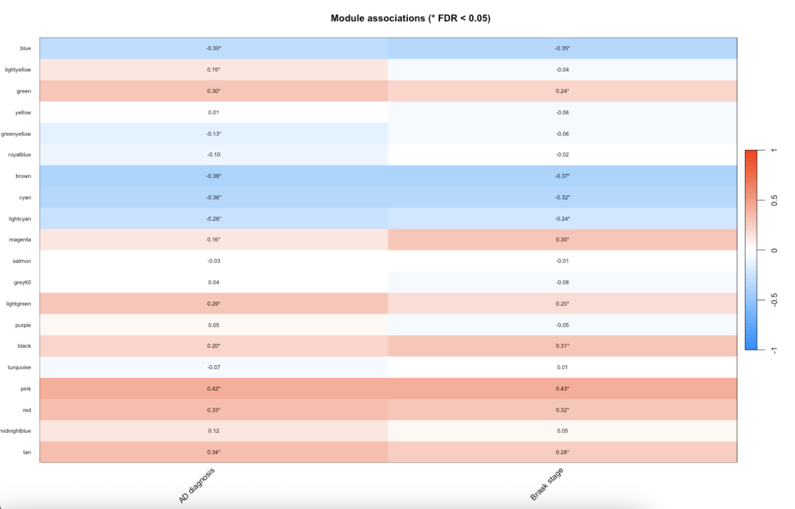
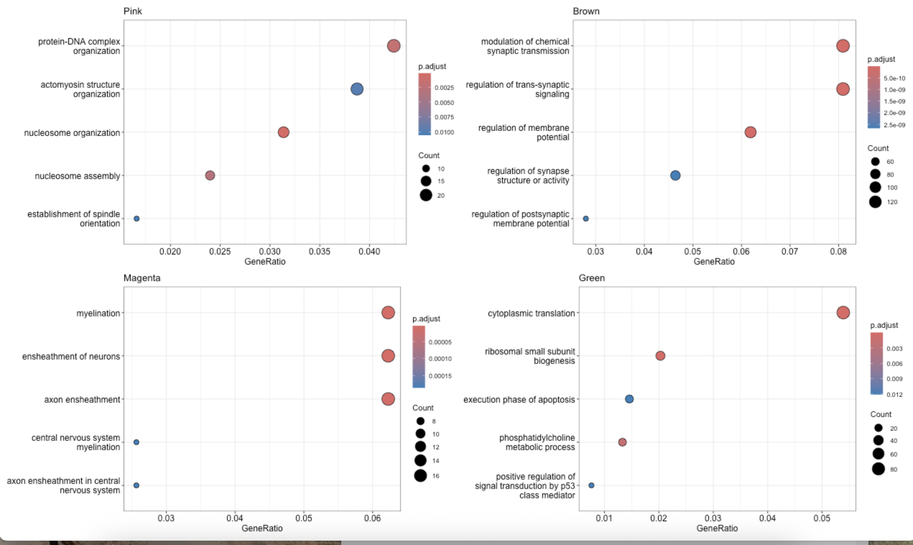
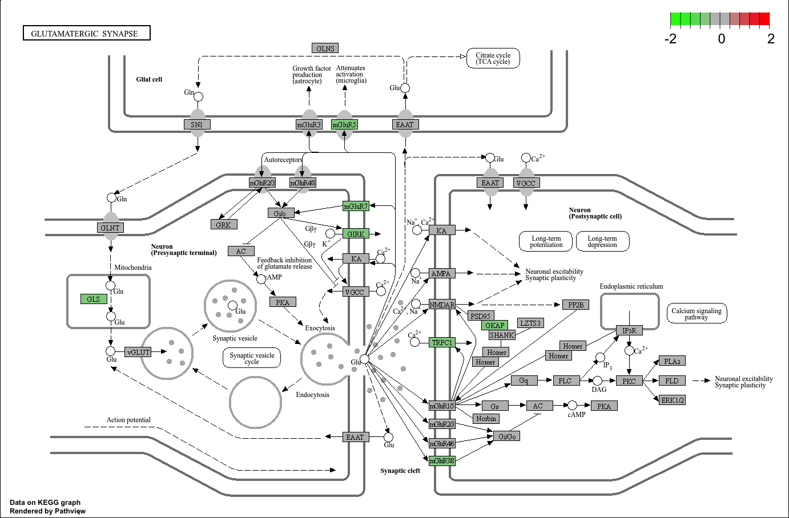

```{r setup, include=FALSE}
knitr::opts_chunk$set(echo = TRUE, warning = FALSE, message = FALSE)
```

# Sammendrag
150 ord - spørsmål -> data -> metode -> hovedfunn -> betydning

# Innledning
~300 ord. Plan: AD → Braak → fusiform gyrus → kunnskapshull + spørsmål.
Unsupervised learning: (a) PCA/hierarchal clustering/heatmap to get an initial overview of the data, (b) network analysis and module detection, (c) GO enrichment analysis of modules, (d) pathway analysis of selected pathways. Work in groups of four.


## Forskningsspørsmål

Er genmodulene (koekspresjonsmoduler) som er assosiert med Braak-stadium i fusiform gyrus, de samme som er assosiert med Alzheimer-diagnose, og hvilke funksjoner har de?


# Metode

Vi fulgte et ikke-veiledet analyseløp (unsupervised learning). Etter forbehandling og en utforskende analyse fant vi genmoduler med WGCNA, testet om modulene var assosiert med diagnose og Braak-stadium, og undersøkte hvilke funksjoner de har. Differensielt uttrykk og pathway-analyse ble brukt som støtte.

## Oversikt over analysen

1.  **Forbehandling:** filtrering og VST (lab 2)
2.  **Utforskende analyse:** PCA og hierarkisk klustering (lab 4)
3.  **Koekspresjonsnettverk:** WGCNA (lab 6)
4.  **Moduler og kliniske variabler:** korrelasjoner og lineære modeller (lab 6)
5.  **Funksjonell anrikning:** GO, KEGG og regulatorer (lab 3 og 7)
6.  **Differensielt uttrykk og pathway-analyse:** DESeq2 og pathview (lab 3 og 7)
7.  **Hub-gener:** genene med høyest kME (lab 6)

## Data

Genuttrykksdataene ble hentet fra Gene Expression Omnibus (GEO; tilgangsnummer GSE125583) (Srinivasan et al. 2020). Dataene er offentlig tilgjengelige og kan gjenbrukes, i tråd med FAIR-prinsippene (Wilkinson et al. 2016).

Datasettet består av bulk RNA-seq av post mortem-vev fra fusiform gyrus fra 219 pasienter med Alzheimers sykdom (AD) og 70 aldersmatchede, nevrologisk friske kontroller, sekvensert på Illumina HiSeq 2500.

Vi brukte tabellen med rå gentellinger laget av NCBI (reads mappet mot GRCh38.p13; 39 376 gener). Diagnose, alder, kjønn og Braak-stadium (I–VI) ble hentet fra GEO series matrix. Braak-stadium manglet for to prøver, og alder og kjønn for én prøve hver. Vi kontrollerte at prøve-ID-ene i gentellingstabellen og prøveinformasjonen samsvarte og sto i samme rekkefølge.

```{r, innlesing}
# Gentellinger: gener i rader og prøver i kolonner
counts <- read.delim(
  "data/GSE125583_raw_counts.tsv.gz",
  row.names = 1,
  check.names = FALSE
)

# Informasjon om hver prøve
traits <- read.csv(
  "data/GSE125583_traits.csv",
  stringsAsFactors = FALSE
)

# kontroll av innlesningene
dim(counts)
dim(traits)

counts[1:4, 1:4]
head(traits)
```

## Forbehandling

Gener med minst 10 tellinger i minst 20 % av prøvene (58 av 289) ble beholdt, slik at 21 487 gener gjensto. Tellingene ble normalisert for bibliotekstørrelse og transformert med variansstabiliserende transformasjon (VST) i DESeq2 (Love et al. 2014).

```{r, filtrere data}
# Minste antall prøver: 20 % av alle prøvene, rundet opp
min.samples <- ceiling(0.20 * ncol(counts))

# Behold gener med minst 10 tellinger i minst dette antallet prøver
keep <- rowSums(counts >= 10) >= min.samples
counts.filtered <- counts[keep, , drop = FALSE]

# Kontroller antall prøver som kreves og antall gener som beholdes
min.samples
nrow(counts.filtered)
```

```{r, normalisering}
library(DESeq2)

# Bruk prøve-ID-ene som radnavn i prøveinformasjonen
rownames(traits) <- traits$sample

# Samle gentellinger og prøveinformasjon i et DESeq2-objekt
dds <- DESeqDataSetFromMatrix(
  countData = as.matrix(counts.filtered),
  colData = traits,
  design = ~ 1
)

# Beregn normaliseringsfaktorer for prøvene
dds <- estimateSizeFactors(dds)

# VST-transformer og hent ut uttrykksmatrisen
vst <- varianceStabilizingTransformation(dds, blind = TRUE)
expr <- assay(vst)

dim(expr)
```

## Utforskende analyse

For å undersøke de største variasjonsmønstrene i genuttrykket brukte vi prinsipalkomponentanalyse (PCA) av alle VST-genene. Prøvene ble farget etter diagnose og Braak-stadium for å se om disse variablene samsvarte med mønstrene. Likheter mellom prøvene ble undersøkt med hierarkisk klustering (euklidsk avstand, complete linkage).

## Koekspresjonsnettverk

Et signert koekspresjonsnettverk ble bygget fra alle 21 487 genene med WGCNA (Langfelder & Horvath 2008), slik at bare positivt korrelerte gener havner i samme modul. Soft-thresholding power ble satt til 20, den laveste verdien som ga et tilnærmet skalafritt nettverk (R² ≥ 0,80). Modulene ble funnet med `blockwiseModules` (maksimal blokkstørrelse 5 000 gener, minste modulstørrelse 40, terskel for sammenslåing 0,25). Gener uten modul får fargen grey. Fordi WGCNA ga ulike moduler på to datamaskiner, ble modulene lagret i én fil og brukt i alle videre analyser.

## Moduler og kliniske variabler

Hver modul ble oppsummert med sin eigengene, den første prinsipalkomponenten av modulens gener. Eigengenene ble korrelert med diagnose (AD = 1, kontroll = 0; Pearson) og Braak-stadium (kodet 1–6; Spearman). Sammenhengen med diagnose ble også testet i lineære modeller justert for alder og kjønn. For å skille patologi fra klinisk diagnose ble en felles modell med diagnose, Braak-stadium (som faktor), alder og kjønn sammenlignet med reduserte modeller uten Braak-stadium eller uten diagnose, med F-tester. P-verdiene ble justert med Benjamini–Hochberg-metoden, og FDR \< 0,05 ble regnet som signifikant (Benjamini & Hochberg 1995).

## Funksjonell anrikning

Fire moduler (pink, brown, magenta og green) ble valgt ut til funksjonell analyse. <!-- TODO: legg til én setning om HVORFOR disse fire ble valgt --> Anrikning av Gene Ontology biologiske prosesser og KEGG-pathways ble testet med clusterProfiler (Xu et al. 2024), med alle nettverksgenene som bakgrunn. P-verdiene ble justert med Benjamini–Hochberg-metoden, med FDR < 0,05 som grense. Mulige oppstrøms regulatorer ble undersøkt med ChEA 2022-biblioteket i Enrichr, som inneholder kjente målgener for transkripsjonsfaktorer (Kuleshov et al. 2016).

## Differensielt uttrykk og pathway-analyse

Differensielt uttrykk ble testet med DESeq2 på de filtrerte råtellingene i de 287 prøvene med fullstendig informasjon, med designet `~ age + sex + braak + diagnosis`. AD og kontroller ble sammenlignet med en Wald-test. Effekten av Braak-stadium utover diagnose ble testet med en likelihood ratio-test mot den reduserte modellen `~ age + sex + diagnosis`, som tester alle Braak-stadiene samlet. Gener med justert p \< 0,05 ble regnet som signifikante. Log2-foldendringer for AD mot kontroll ble lagt inn i KEGG-pathwayen for glutamaterg synapse (hsa04724) med pathview (Luo & Brouwer 2013).

## Hub-gener

Hub-gener ble definert som de ti genene med høyest modultilhørighet (kME) i hver valgt modul, altså sterkest korrelasjon med modulens eigengene. Vi undersøkte om hub-genene også var signifikante i DESeq2-analysene.

## Programvare

Alle analysene ble gjort i R (versjon `r getRversion()`) med DESeq2 (`r packageVersion("DESeq2")`), WGCNA (`r packageVersion("WGCNA")`), clusterProfiler (`r packageVersion("clusterProfiler")`), org.Hs.eg.db (`r packageVersion("org.Hs.eg.db")`), enrichR (`r packageVersion("enrichR")`), pathview (`r packageVersion("pathview")`), enrichplot, patchwork og ggplot2 (`r packageVersion("ggplot2")`).

# Resultater

## Oversikt

```{r, PCA, alzheimer og kontrollgruppe}
library(ggplot2)

# PCA trenger prøver i rader og gener i kolonner
pca <- prcomp(t(expr), center = TRUE, scale. = FALSE)

# Prosent av variasjonen forklart av hver hovedkomponent
variance <- 100 * pca$sdev^2 / sum(pca$sdev^2)

# Samle koordinater og diagnose
pca.data <- data.frame(
  PC1 = pca$x[, 1],
  PC2 = pca$x[, 2],
  diagnosis = traits$diagnosis
)

# Tegn PCA-plottet
ggplot(pca.data, aes(x = PC1, y = PC2, color = diagnosis)) +
  geom_point(alpha = 0.7) +
  labs(
    x = paste0("PC1 (", round(variance[1], 1), "%)"),
    y = paste0("PC2 (", round(variance[2], 1), "%)"),
    color = "Diagnosis"
  ) +
  theme_bw()
```

```{r, PCA Braak stadium}
# Legg til Braak-stadium i riktig rekkefølge
pca.data$braak <- factor(
  traits$braak,
  levels = c("I", "II", "III", "IV", "V", "VI")
)

# Samme PCA, farget etter Braak-stadium
ggplot(pca.data, aes(x = PC1, y = PC2, color = braak)) +
  geom_point(alpha = 0.7) +
  scale_color_viridis_d(na.value = "grey") +
  labs(
    x = paste0("PC1 (", round(variance[1], 1), "%)"),
    y = paste0("PC2 (", round(variance[2], 1), "%)"),
    color = "Braak stage"
  ) +
  theme_bw()

```


PC1 forklarte 26 % og PC2 forklarte 22 % av variasjonen i genuttrykket. Begge figurene viser samme PCA, men med ulik fargelegging. Alzheimer-gruppen og kontrollgruppen overlappet, men kontrollprøvene lå hovedsakelig mot høyre langs PC1, mens Alzheimer-prøvene var mer spredt (figur 1). Prøver med høyere Braak-stadium hadde en tendens til å ligge mot venstre langs PC1, mens lavere stadier oftere lå mot høyre (figur 2). Det var likevel ingen tydelig atskillelse mellom gruppene.


```{r, clustering}
library(WGCNA)

# Beregn avstand mellom prøvene og lag treet
sample.dist <- dist(t(expr), method = "euclidean")
sample.tree <- hclust(sample.dist, method = "complete")

# Farger for diagnose: AD = laksefarget, kontroll = turkis
diagnosis.colors <- ifelse(
  traits$diagnosis == "AD",
  "salmon",
  "turquoise"
)
diagnosis.colors[is.na(traits$diagnosis)] <- "grey"

# Farger for Braak-stadium I–VI
braak.palette <- c(
  I = "#440154",
  II = "#414487",
  III = "#2A788E",
  IV = "#22A884",
  V = "#7AD151",
  VI = "#FDE725"
)

braak.colors <- unname(
  braak.palette[as.character(traits$braak)]
)
braak.colors[is.na(braak.colors)] <- "grey"

# Samle fargestripene
trait.colors <- cbind(
  Diagnosis = diagnosis.colors,
  Braak = braak.colors
)

# Tegn treet med fargestriper
plotDendroAndColors(
  sample.tree,
  colors = trait.colors,
  groupLabels = c("Diagnosis", "Braak"),
  dendroLabels = FALSE,
  main = "Sample clustering with diagnosis and Braak stage"
)

```


## Koekspresjonsmoduler

```{r, WGCNA prep}
# Snu matrisen: prøver i rader, gener i kolonner
datExpr <- t(expr)

# Kontroller manglende verdier og gener uten variasjon
gsg <- WGCNA::goodSamplesGenes(datExpr, verbose = 3)

# Vis om alle prøver og gener bestod kontrollen
gsg$allOK

# Vis antall prøver og gener
dim(datExpr)

```

```{r power, cache = TRUE}

# Test flere power-verdier
powers <- c(1:10, seq(12, 30, by = 2))

sft <- WGCNA::pickSoftThreshold(
  datExpr,
  powerVector = powers,
  networkType = "signed",
  RsquaredCut = 0.80,
  blockSize = 1000,
  verbose = 5
)

# Vis foreslått power og resultatene
sft$powerEstimate
sft$fitIndices
softPower <- 20

```

```{r WGCNA, cache = TRUE, results = 'hide', message = FALSE}

# Modulene lagres i en fil, slik at alle maskiner får de samme modulene
modules.file <- "data/wgcna_modules.rds"

if (file.exists(modules.file)) {
  # Bruk modulene som allerede er beregnet (Charlenes)
  modules <- readRDS(modules.file)
} else {
  # Gjør analysen mer reproduserbar
  set.seed(3)

  # Finn genmoduler
  modules <- WGCNA::blockwiseModules(
    datExpr,
    power = softPower,
    networkType = "signed",
    TOMType = "signed",
    minModuleSize = 40,
    mergeCutHeight = 0.25,
    maxBlockSize = 5000,
    numericLabels = FALSE,
    randomSeed = 3,
    verbose = 3
  )

  # Lagre modulene til neste knit
  saveRDS(modules, modules.file)
}

# Antall gener i hver modul
table(modules$colors)

# Hent modulenes oppsummerte uttrykksprofiler
MEs <- modules$MEs
```

```{r, module size}

table(modules$colors)
```

WGCNA identifiserte 20 genmoduler, mens 3 216 gener ikke ble tildelt en modul.


## Moduler og kliniske variabler

```{r, klargjor traits}

# Diagnose: kontroll = 0, AD = 1
traits$AD <- ifelse(traits$diagnosis == "AD", 1, 0)

# Gjør Braak I–VI om til tallene 1–6
traits$braak.numeric <- match(
  traits$braak,
  c("I", "II", "III", "IV", "V", "VI")
)

# Kontroller omkodingen
table(traits$diagnosis, traits$AD, useNA = "ifany")
table(traits$braak, traits$braak.numeric, useNA = "ifany")
```

```{r, sammenhenger}

# Utelat grey, som inneholder gener uten modultilhørighet
MEs <- modules$MEs
MEs <- MEs[, colnames(MEs) != "MEgrey", drop = FALSE]

# Sett prøveinformasjonen i samme rekkefølge som eigengenene
trait.data <- traits[
  match(rownames(MEs), traits$sample),
]

stopifnot(identical(rownames(MEs), trait.data$sample))

# Test sammenheng med diagnose og Braak for hver modul
module.results <- do.call(
  rbind,
  lapply(colnames(MEs), function(module) {

    diagnosis.test <- cor.test(
      MEs[[module]], trait.data$AD,
      method = "pearson"
    )

    braak.test <- cor.test(
      MEs[[module]], trait.data$braak.numeric,
      method = "spearman",
      exact = FALSE
    )

    data.frame(
      Module = sub("^ME", "", module),
      Diagnosis_r = unname(diagnosis.test$estimate),
      Diagnosis_p = diagnosis.test$p.value,
      Braak_rho = unname(braak.test$estimate),
      Braak_p = braak.test$p.value
    )
  })
)

# Korriger for at vi tester mange moduler

module.results$Diagnosis_FDR <- p.adjust(
  module.results$Diagnosis_p, method = "BH"
)

module.results$Braak_FDR <- p.adjust(
  module.results$Braak_p, method = "BH"
)

# Vis resultatene
module.results

```

```{r, heatmap}

# Samle korrelasjonene i en matrise
cor.matrix <- as.matrix(
  module.results[, c("Diagnosis_r", "Braak_rho")]
)

rownames(cor.matrix) <- module.results$Module
colnames(cor.matrix) <- c("AD diagnosis", "Braak stage")

# Samle korrigerte p-verdier
fdr.matrix <- as.matrix(
  module.results[, c("Diagnosis_FDR", "Braak_FDR")]
)

# Vis korrelasjon og marker FDR < 0.05 med stjerne
plot.labels <- matrix(
  paste0(
    sprintf("%.2f", cor.matrix),
    ifelse(fdr.matrix < 0.05, "*", "")
  ),
  nrow = nrow(cor.matrix),
  ncol = ncol(cor.matrix)
)

# Tegn heatmap
WGCNA::labeledHeatmap(
  Matrix = cor.matrix,
  xLabels = colnames(cor.matrix),
  yLabels = rownames(cor.matrix),
  ySymbols = rownames(cor.matrix),
  colorLabels = FALSE,
  colors = WGCNA::blueWhiteRed(50),
  textMatrix = plot.labels,
  setStdMargins = FALSE,
  plotLegend = TRUE,
  zlim = c(-1, 1),
  cex.text = 0.7,
  main = "Module associations (* FDR < 0.05)",
  cex.lab.y = 0.7,
  margins = c(7, 10)
)

```



I de ujusterte analysene var 13 moduler signifikant assosiert med Alzheimer-diagnose og 11 med Braak-stadium (FDR < 0,05). Alle de 11 Braak-assosierte modulene var også assosiert med diagnose (figur 3). Pink-modulen hadde den sterkeste positive korrelasjonen med begge variablene (henholdsvis 0,42 og 0,43), mens brown-modulen hadde den sterkeste negative korrelasjonen (−0,38 og −0,37).


```{r, sammenheng med diagnose når kjønn og alder tas med}

# Klargjør alder og kjønn
trait.data$age <- as.numeric(trait.data$age)
trait.data$sex <- factor(trait.data$sex)

# Undersøk hver modul, justert for alder og kjønn
adjusted.results <- do.call(
  rbind,
  lapply(colnames(MEs), function(module) {

    model.data <- data.frame(
      ME = MEs[[module]],
      AD = trait.data$AD,
      age = trait.data$age,
      sex = trait.data$sex
    )

    model <- lm(ME ~ AD + age + sex, data = model.data)
    result <- coef(summary(model))

    data.frame(
      Module = sub("^ME", "", module),
      AD_difference = result["AD", "Estimate"],
      AD_p = result["AD", "Pr(>|t|)"],
      Samples = nobs(model)
    )
  })
)

# Korriger for testing av mange moduler

adjusted.results$AD_FDR <- p.adjust(
  adjusted.results$AD_p,
  method = "BH"
)

# Vis de minste korrigerte p-verdiene først

adjusted.results <- adjusted.results[
  order(adjusted.results$AD_FDR),
]

adjusted.results
```

```{r, diagnose og braak}

# Sett Braak-stadiene i riktig rekkefølge
braak.stage <- factor(
  traits$braak,
  levels = c("I", "II", "III", "IV", "V", "VI")
)

# Tell prøver per diagnose og Braak-stadium
table(
  Diagnosis = traits$diagnosis,
  Braak = braak.stage,
  useNA = "ifany"
)
```

```{r, moduler-diagnos-braak}

# Braak behandles som seks kategorier
trait.data$braak.factor <- factor(
  trait.data$braak,
  levels = c("I", "II", "III", "IV", "V", "VI")
)

joint.results <- do.call(
  rbind,
  lapply(colnames(MEs), function(module) {

    model.data <- data.frame(
      ME = MEs[[module]],
      AD = trait.data$AD,
      braak = trait.data$braak.factor,
      age = trait.data$age,
      sex = trait.data$sex
    )

    # Bruk de samme prøvene i alle modellene
    model.data <- model.data[complete.cases(model.data), ]

    full.model <- lm(
      ME ~ AD + braak + age + sex,
      data = model.data
    )

    # Test diagnose utover Braak, alder og kjønn
    without.AD <- update(full.model, . ~ . - AD)

    # Test Braak samlet utover diagnose, alder og kjønn
    without.braak <- update(full.model, . ~ . - braak)

    data.frame(
      Module = sub("^ME", "", module),
      Diagnosis_p = anova(without.AD, full.model)[2, "Pr(>F)"],
      Braak_p = anova(without.braak, full.model)[2, "Pr(>F)"],
      Samples = nobs(full.model)
    )
  })
)

# Korriger for testing av mange moduler
joint.results$Diagnosis_FDR <- p.adjust(
  joint.results$Diagnosis_p, method = "BH"
)

joint.results$Braak_FDR <- p.adjust(
  joint.results$Braak_p, method = "BH"
)

joint.results

```

Etter justering for alder og kjønn var 12 moduler signifikant assosiert med Alzheimer. Når også Braak-stadium ble inkludert i modellen, var 10 moduler assosiert med diagnose og seks med Braak-stadium. Fire moduler – blue, brown, pink og red – var assosiert med begge (FDR < 0,05).


## Funksjonell anrikning

```{r, genlister moduler}

# Kontroller at hvert gen har en modulmerking
stopifnot(length(modules$colors) == ncol(datExpr))

# Modulene vi vil undersøke videre
selected.modules <- c("pink", "brown", "magenta", "green")

# Hent gen-ID-ene fra hver modul
module.genes <- setNames(
  lapply(selected.modules, function(module) {
    colnames(datExpr)[modules$colors == module]
  }),
  selected.modules
)

# Antall gener i hver liste
lengths(module.genes)

# Alle gener som inngikk i WGCNA, til bakgrunn for GO-analysen
background.genes <- colnames(datExpr)

```

```{r GO, cache = TRUE}
library(clusterProfiler)
library(org.Hs.eg.db)

# GO-analyse av biologiske prosesser i pink-modulen
go.pink <- enrichGO(
  gene = module.genes$pink,
  universe = background.genes,
  OrgDb = org.Hs.eg.db,
  keyType = "ENTREZID",
  ont = "BP",
  pAdjustMethod = "BH",
  pvalueCutoff = 0.05,
  qvalueCutoff = 0.05,
  readable = TRUE
)

# Vis de første resultatene
head(as.data.frame(go.pink)[, c(
  "Description", "GeneRatio", "p.adjust", "Count"
)])


# Samme analyse for de tre neste modulene
other.modules <- c("brown", "magenta", "green")

go.other <- setNames(
  lapply(other.modules, function(module) {
    enrichGO(
      gene = module.genes[[module]],
      universe = background.genes,
      OrgDb = org.Hs.eg.db,
      keyType = "ENTREZID",
      ont = "BP",
      pAdjustMethod = "BH",
      pvalueCutoff = 0.05,
      qvalueCutoff = 0.05,
      readable = TRUE
    )
  }),
  other.modules
)

# Vis de seks første resultatene for hver modul
for (module in other.modules) {
  cat("\nModul:", module, "\n")

  results <- as.data.frame(go.other[[module]])

  print(head(results[, c(
    "Description", "GeneRatio", "p.adjust", "Count"
  )]))
}

```


```{r, GO figur}

# Samle resultatene fra alle fire modulene
go.all <- c(list(pink = go.pink), go.other)

# Lag én figur per modul
for (module in names(go.all)) {
  if (nrow(as.data.frame(go.all[[module]])) > 0) {
    print(
      enrichplot::dotplot(
        go.all[[module]],
        showCategory = 10
      ) +
        ggplot2::ggtitle(paste("GO biological processes:", module))
    )
  }
}


```
```{r, samle GO figurene}
library(enrichplot)
library(ggplot2)
library(patchwork)

# Lag ett plott for hver modul
p.pink <- dotplot(go.pink, showCategory = 5) +
  ggtitle("Pink")

p.brown <- dotplot(go.other[["brown"]], showCategory = 5) +
  ggtitle("Brown")

p.magenta <- dotplot(go.other[["magenta"]], showCategory = 5) +
  ggtitle("Magenta")

p.green <- dotplot(go.other[["green"]], showCategory = 5) +
  ggtitle("Green")

# Samle plottene i to rader
go.figure <- (p.pink | p.brown) / (p.magenta | p.green)

go.figure

# Lagre bildet i prosjektmappen
ggsave("GO_modules.png", go.figure,
       width = 14, height = 11, units = "in", dpi = 300)
       
```



GO-analysen viste at gener knyttet til nukleosomorganisering og organisering av protein–DNA-komplekser var overrepresentert i pink-modulen. I brown-modulen var gener knyttet til signaloverføring mellom nerveceller overrepresentert. Magenta-modulen hadde overrepresentasjon av gener knyttet til dannelse av myelin, det isolerende laget rundt aksoner. I green-modulen var det sterkeste funnet knyttet til proteinsyntese i cytoplasmaet (figur 4). Alle disse funnene hadde justert p-verdi < 0,05.


```{r KEGG, cache = TRUE}
# KEGG-analyse for hver av de fire modulene
kegg.results <- setNames(
  lapply(names(module.genes), function(module) {
    clusterProfiler::enrichKEGG(
      gene = module.genes[[module]],
      universe = background.genes,
      organism = "hsa",
      keyType = "ncbi-geneid",
      pAdjustMethod = "BH",
      pvalueCutoff = 0.05,
      qvalueCutoff = 0.05
    )
  }),
  names(module.genes)
)

# Vis de første resultatene for hver modul
for (module in names(kegg.results)) {
  cat("\nModul:", module, "\n")

  results <- as.data.frame(kegg.results[[module]])

  print(head(results[, c(
    "ID", "Description", "GeneRatio", "p.adjust", "Count"
  )]))
}

```

KEGG-analysen viste overrepresentasjon av gener knyttet til ATP-avhengig kromatinremodellering i pink-modulen, nevroaktiv signalering og glutamaterg synapse i brown-modulen, steroidbiosyntese i magenta-modulen og ribosomer i green-modulen (justert p < 0,05).


```{r regulatoranalyse, cache = TRUE}
library(enrichR)

# Hent oversikten over tilgjengelige databaser
enrichr.databases <- enrichR::listEnrichrDbs()

# Vis databaser med ChEA i navnet
enrichr.databases[
  grepl("ChEA", enrichr.databases$libraryName),
  "libraryName",
  drop = FALSE
]

# Koble Entrez-ID-er til vanlige gennavn
gene.symbols <- AnnotationDbi::mapIds(
  org.Hs.eg.db,
  keys = as.character(background.genes),
  column = "SYMBOL",
  keytype = "ENTREZID",
  multiVals = "first"
)

# Bakgrunn: alle kartlagte gener fra WGCNA
background.symbols <- unique(
  na.omit(unname(gene.symbols))
)

# Gennavn for hver modul
module.symbols <- lapply(module.genes, function(genes) {
  unique(na.omit(
    unname(gene.symbols[as.character(genes)])
  ))
})

# Kjør regulatoranalysen separat for hver modul
regulator.results <- lapply(
  module.symbols,
  function(genes) {
    enrichR::enrichr(
      genes = genes,
      databases = "ChEA_2022",
      background = background.symbols
    )[["ChEA_2022"]]
  }
)

# Vis opptil fem signifikante treff per modul
for (module in names(regulator.results)) {
  cat("\nModul:", module, "\n")

  result <- regulator.results[[module]]
  result <- result[
    !is.na(result$Adjusted.P.value) &
      result$Adjusted.P.value < 0.05,
    ,
    drop = FALSE
  ]

  result <- result[order(result$Adjusted.P.value), ]

  print(head(
    result[, c("Term", "Adjusted.P.value")],
    5
  ))
}
```

Regulatoranalysen viste overrepresentasjon av kjente målgener for blant annet FOXA2 i pink-modulen, SMAD4 og TCF4 i brown-modulen og MYC i green-modulen. Magenta-modulen hadde ingen signifikante treff i ChEA_2022 (justert p < 0,05).


## Differensielt uttrykk

```{r, DESeq2-klargjoring}
# Lag en egen kopi av prøveinformasjonen
de.traits <- traits

# Klargjør variablene
de.traits$diagnosis <- factor(
  de.traits$diagnosis,
  levels = c("control", "AD")
)

de.traits$braak <- factor(
  de.traits$braak,
  levels = c("I", "II", "III", "IV", "V", "VI")
)

de.traits$age <- as.numeric(de.traits$age)
de.traits$sex <- factor(de.traits$sex)

# Behold prøver med informasjon om alle fire variablene
keep.samples <- complete.cases(
  de.traits[, c("diagnosis", "braak", "age", "sex")]
)

de.traits <- de.traits[keep.samples, ]
rownames(de.traits) <- de.traits$sample

# Hent råtellingene i samme rekkefølge som prøveinformasjonen
de.counts <- as.matrix(
  counts.filtered[, de.traits$sample, drop = FALSE]
)

# Kontroller at rekkefølgen matcher
stopifnot(
  identical(colnames(de.counts), rownames(de.traits))
)

# Samle dataene i et nytt DESeq2-objekt
dds.de <- DESeq2::DESeqDataSetFromMatrix(
  countData = de.counts,
  colData = de.traits,
  design = ~ age + sex + braak + diagnosis
)

# Kontroller antall gener og prøver
dim(dds.de)

```

```{r DESeq2-diagnose, cache = TRUE}
# Kjør analysen
dds.de <- DESeq2::DESeq(dds.de)

# AD sammenlignet med kontroll
res.AD <- DESeq2::results(
  dds.de,
  contrast = c("diagnosis", "AD", "control"),
  alpha = 0.05
)

# Antall signifikante gener etter korreksjon for mange tester
sum(res.AD$padj < 0.05, na.rm = TRUE)

# Vis de seks genene med lavest korrigert p-verdi
res.AD.sorted <- res.AD[order(res.AD$padj), ]

head(as.data.frame(res.AD.sorted)[, c(
  "baseMean", "log2FoldChange", "pvalue", "padj"
)])

```

```{r DESeq2-braak, cache = TRUE}

# Test hva Braak tilfører utover alder, kjønn og diagnose
dds.braak <- DESeq2::nbinomLRT(
  dds.de,
  reduced = ~ age + sex + diagnosis
)

res.braak <- DESeq2::results(
  dds.braak,
  alpha = 0.05
)

# Antall signifikante gener for hver analyse
c(
  AD = sum(res.AD$padj < 0.05, na.rm = TRUE),
  Braak = sum(res.braak$padj < 0.05, na.rm = TRUE)
)

# Vis de seks sterkeste Braak-resultatene
res.braak.sorted <- res.braak[order(res.braak$padj), ]

head(as.data.frame(res.braak.sorted)[, c(
  "baseMean", "stat", "pvalue", "padj"
)])

c(
  AD = sum(res.AD$padj < 0.05, na.rm = TRUE),
  Braak = sum(res.braak$padj < 0.05, na.rm = TRUE)
)
```

DESeq2 identifiserte 8 473 gener assosiert med diagnose og 3 205 med Braak-stadium etter justering for alder, kjønn og henholdsvis Braak eller diagnose (FDR < 0,05).


```{r, kontoll gen 4490}
# Hent normaliserte tellinger for genet
gene.check <- data.frame(
  sample = colnames(dds.de),
  expression = as.numeric(
    DESeq2::counts(dds.de, normalized = TRUE)["4490", ]
  ),
  braak = colData(dds.de)$braak,
  diagnosis = colData(dds.de)$diagnosis
)

# Vis uttrykket i hver prøve, gruppert etter Braak
ggplot2::ggplot(
  gene.check,
  ggplot2::aes(
    x = braak,
    y = log2(expression + 1),
    color = diagnosis
  )
) +
  ggplot2::geom_jitter(width = 0.15, height = 0, alpha = 0.7) +
  ggplot2::labs(
    title = "Kontroll av gen 4490",
    x = "Braak-stadium",
    y = "log2(normaliserte tellinger + 1)",
    color = "Diagnose"
  ) +
  ggplot2::theme_bw()

# Vis prøvene med høyest uttrykk
head(
  gene.check[order(gene.check$expression, decreasing = TRUE), ],
  10
)
# Vis hele Braak-resultatet for genet
as.data.frame(res.braak["4490", ])

# Undersøk prøvenes innflytelse på modellen
cooks.4490 <- assays(dds.de)[["cooks"]]["4490", ]

# Vis de fem høyeste Cook's distance-verdiene
head(sort(cooks.4490, decreasing = TRUE), 5)

# Hent informasjon om modelltilpasningen
fit.check <- as.data.frame(S4Vectors::mcols(dds.braak))

# Vis konvergensinformasjon for gen 4490
fit.columns <- grep(
  "Conv",
  colnames(fit.check),
  value = TRUE
)

fit.check["4490", fit.columns, drop = FALSE]
```


## Pathway-analyse

```{r pathway-synapse, cache = TRUE}

library(pathview)
data("bods", package = "pathview")
data("korg", package = "pathview")

# Hent log2-fold change og bruk Entrez-ID som navn
gene.effects <- res.AD$log2FoldChange
names(gene.effects) <- rownames(res.AD)

# Fjern verdier som mangler eller ikke er endelige
gene.effects <- gene.effects[is.finite(gene.effects)]

# Lag en mappe til figuren
dir.create("figures", showWarnings = FALSE)

# Tegn pathway-kartet
pv.synapse <- pathview::pathview(
  gene.data = gene.effects,
  gene.idtype = "entrez",
  pathway.id = "04724",
  species = "hsa",
  node.sum = "mean",
  limit = list(gene = 2),
  out.suffix = "AD_vs_control",
  kegg.dir = "figures"
)

# Vis figuren i R Markdown


```

Pathview-figuren for glutamaterg synapse viste lavere uttrykk av flere kartlagte gener i Alzheimer-gruppen sammenlignet med kontrollgruppen.


## Hub-gener

```{r, hub gener}
# Finn de ti genene som følger hver modul tettest
hub.genes <- do.call(
  rbind,
  lapply(names(module.genes), function(module) {

    genes <- module.genes[[module]]

    # Korrelasjon mellom hvert gen og modulens eigengene
    kME <- as.numeric(cor(
      datExpr[, genes, drop = FALSE],
      MEs[[paste0("ME", module)]],
      use = "pairwise.complete.obs"
    ))

    result <- data.frame(
      Module = module,
      EntrezID = genes,
      kME = kME
    )

    result <- result[order(result$kME, decreasing = TRUE), ]
    head(result, 10)
  })
)

# Legg til vanlige gennavn
hub.genes$Symbol <- unname(
  AnnotationDbi::mapIds(
    org.Hs.eg.db,
    keys = as.character(hub.genes$EntrezID),
    column = "SYMBOL",
    keytype = "ENTREZID",
    multiVals = "first"
  )
)

hub.genes

# Hent korrigerte p-verdier fra DESeq2
hub.genes$AD_FDR <- res.AD$padj[
  match(hub.genes$EntrezID, rownames(res.AD))
]

hub.genes$Braak_FDR <- res.braak$padj[
  match(hub.genes$EntrezID, rownames(res.braak))
]

# Marker signifikante sammenhenger
hub.genes$AD_significant <- (
  !is.na(hub.genes$AD_FDR) & hub.genes$AD_FDR < 0.05
)

hub.genes$Braak_significant <- (
  !is.na(hub.genes$Braak_FDR) & hub.genes$Braak_FDR < 0.05
)

hub.genes

```

Blant de ti utvalgte hub-genene i hver modul var alle ti i brown-modulen signifikant assosiert med både diagnose og Braak. I pink-modulen var alle ti assosiert med diagnose og ni med Braak.


```{r}

```


# Diskusjon


# Referanser


