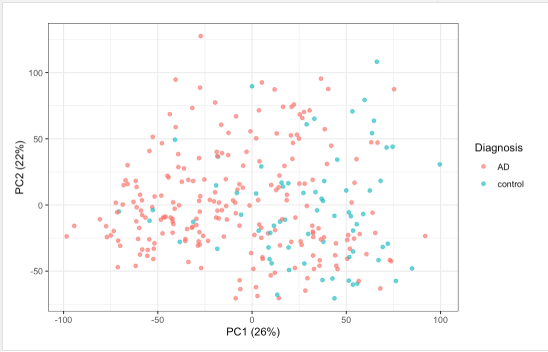
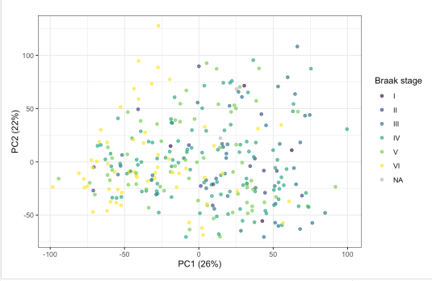
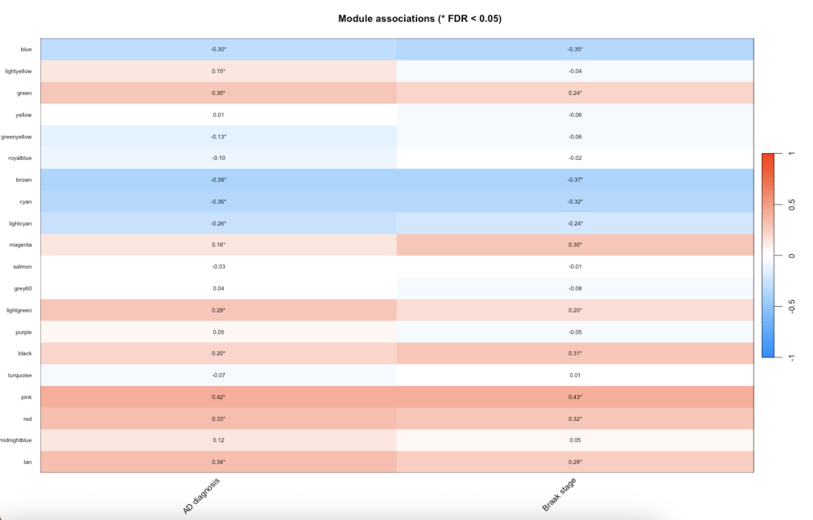
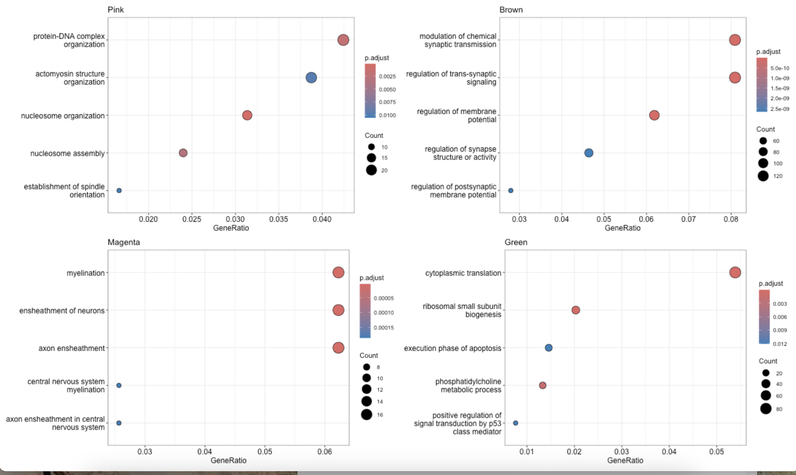

```{r setup, include=FALSE}
knitr::opts_chunk$set(echo = TRUE, warning = FALSE, message = FALSE)
```


# Abstract


# Introduction


# Methods
Vi analyserte RNA-seq-data fra datasettet GSE125583 i GEO-databasen. Dataene kom fra hjerneområdet fusiform gyrus, samlet etter dødsfall fra 219 personer med Alzheimer og 70 kontollpersoner. Vi brukte rå gentellinger og kontrollerte først at ID-ene i gantellingstabletten og prøveinformajsonen samsvarte og sto i samme rekkeførlge. Vi beholdt minst 10 tellinger i minst 20% av prøvene, og gjensto derfor med 21 487 gener. Vi brukte DESeq2 til å normalisere gantellingene og utførte deretter en variansstabiliserende transformasjon (VST) for å klargjøre dataene til PCA og WGCNA. 
 
Vi utførste PCA for å undersøke de største variasjonesmønstrene i genuttrykket mellom prøvene. Prøvene ble deretter farget etter diagnose og Braak-stadium for å undersøke om disse variablene samsvrte med mønstrene. Videre ble hierarkisk klustering med eukildsk avstand og complete linkage gjennomført for å undersøke likheter mellom prøvene.  For å gruppere gener med lignende uttrykksmønstre på tvers av prøvene utførte vi WGCNA. Vi undersøkte først ulike power-verdier og landet på 20. Dette var den laveste testede verdien som ga en tilpasning til skalafri nettverksstruktur på R² ≥ 0,8. Denne verdien brukte vi i funksjonen “blockwiseModules()” for å bygge nettverket og finne genmodulene. Vi brukte et signert nettverk, en minste modulstørrelse på 40 gener og en terskel for sammenslåing av moduler på 0,25. For hver modul beregnet vi en module eigengene (ME), som oppsumerer modulens genutrykksmønster. Disse verdiene ble brukt til å undersøke om modules uttrykksmønster var assosiert med Alzheimer diagnose eller Braak-stadium. Vi undersøkte sammenhengen mellom modulenes ME-verdier og diagnose med Pearson-korrelasjon, og mellom ME-verdiene og Braak-stadium med Spearman-korrelasjon. P-verdiene ble korrigert for multippel testing med Benjamini–Hochberg-metoden, og FDR < 0,05 ble brukt som signifikansgrense. For å undersøke om sammenhengen mellom modulenes ME-verdier og diagnose kunne forklares av ulik alder, kjønn eller Braak-stadium, brukte vi lineære modeller. Vi gjorde tilsvarende for Braak-stadium, med justering for diagnose, alder og kjønn. DESeq2 ble brukt på filtrerte råtellinger for å undersøke gener assosiert med diagnose og Braak-stadium, justert for alder, kjønn og den andre sykdomsvariabelen. Vi brukte Wald-test for diagnose og likelihood ratio-test for Braak. Modulene pink, brown, magenta og green ble undersøkt med GO- og KEGG-anrikning, med alle genene i nettverksanalysen som bakgrunn. P-verdier ble BH-korrigert, med FDR < 0,05 som grense. Pathview viste log2-foldendringer mellom AD og kontroll i glutamaterg synapse. De ti genene med høyest kME per valgt modul ble undersøkt som hub-gener. Mulige regulatorer ble undersøkt med Enrichr og ChEA_2022. 

## Data
We will use the publicly available RNA-seq dataset GSE125583 from the Gene Expression Omnibus (GEO). It contains bulk RNA-seq data from post-mortem fusiform gyrus tissue from 289 donors: 219 with autopsy-confirmed Alzheimer’s disease (AD) and 70 neurologically normal, age-matched controls. For each sample, diagnosis, Braak stage (I–VI), age (60–103 years) and sex are available. We will use the raw gene counts generated by NCBI (aligned to the human genome GRCh38.p13), covering 39,376 genes.


## Research question
Are the gene co-expression modules associated with Braak stage in the fusiform gyrus the same as those associated with Alzheimer’s disease diagnosis, and what functions do they have?


## Planned analysis
1. Filtering and normalization (VST), Lab 2
2. Overview: PCA and hierarchical clustering / heatmap, Lab 4
3. Co-expression network and module detection (WGCNA), Lab 6
4. Module–trait association (diagnosis, Braak, age, sex), Lab 6
5. GO enrichment of selected modules, Lab 3/7
6. Pathway analysis of a selected pathway (pathview), Lab 7


# Results


PC1 forklarte 26 % og PC2 forklarte 22 % av variasjonen i genuttrykket. Begge figurene viser samme PCA, men med ulik fargelegging. Alzheimer-gruppen og kontrollgruppen overlappet, men kontrollprøvene lå hovedsakelig mot høyre langs PC1, mens Alzheimer-prøvene var mer spredt (figur 1). Prøver med høyere Braak-stadium hadde en tendens til å ligge mot venstre langs PC1, mens lavere stadier oftere lå mot høyre (figur 2). Det var likevel ingen tydelig atskillelse mellom gruppene.


WGCNA identifiserte 20 genmoduler, mens 3 216 gener ikke ble tildelt en modul. I de ujusterte analysene var 13 moduler signifikant assosiert med Alzheimer-diagnose og 11 med Braak-stadium (FDR < 0,05). Alle de 11 Braak-assosierte modulene var også assosiert med diagnose (figur 3). Pink-modulen hadde den sterkeste positive korrelasjonen med begge variablene (henholdsvis 0,42 og 0,43), mens brown-modulen hadde den sterkeste negative korrelasjonen (−0,38 og −0,37).

Etter justering for alder og kjønn var 12 moduler signifikant assosiert med Alzheimer. Når også Braak-stadium ble inkludert i modellen, var 10 moduler assosiert med diagnose og seks med Braak-stadium. Fire moduler – blue, brown, pink og red – var assosiert med begge (FDR < 0,05).



GO-analysen viste at gener knyttet til nukleosomorganisering og organisering av protein–DNA-komplekser var overrepresentert i pink-modulen. I brown-modulen var gener knyttet til signaloverføring mellom nerveceller overrepresentert. Magenta-modulen hadde overrepresentasjon av gener knyttet til dannelse av myelin, det isolerende laget rundt aksoner. I green-modulen var det sterkeste funnet knyttet til proteinsyntese i cytoplasmaet (figur 4). Alle disse funnene hadde justert p-verdi < 0,05.

KEGG-analysen viste overrepresentasjon av gener knyttet til ATP-avhengig kromatinremodellering i pink-modulen, nevroaktiv signalering og glutamaterg synapse i brown-modulen, steroidbiosyntese i magenta-modulen og ribosomer i green-modulen (justert p < 0,05). Pathview-figuren for glutamaterg synapse viste lavere uttrykk av flere kartlagte gener i Alzheimer-gruppen sammenlignet med kontrollgruppen.

DESeq2 identifiserte 8 473 gener assosiert med diagnose og 3 205 med Braak-stadium etter justering for alder, kjønn og henholdsvis Braak eller diagnose (FDR < 0,05). Blant de ti utvalgte hub-genene i hver modul var alle ti i brown-modulen signifikant assosiert med både diagnose og Braak. I pink-modulen var alle ti assosiert med diagnose og ni med Braak.

Regulatoranalysen viste overrepresentasjon av kjente målgener for blant annet FOXA2 i pink-modulen, SMAD4 og TCF4 i brown-modulen og MYC i green-modulen. Magenta-modulen hadde ingen signifikante treff i ChEA_2022 (justert p < 0,05).

# Discussion


# References
