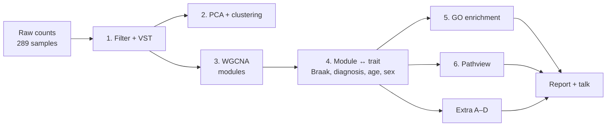
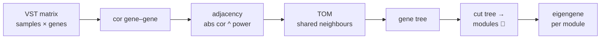

# 📘 Arbeidsbok: BIN315-prosjekt (Alzheimer, GSE125583)

> **Arbeidstittel:** *Analysing Alzheimer's disease progression in the fusiform gyrus using gene co-expression networks*
>
> **Hovedspørsmål:** Hvilke gen-moduler følger **Braak stage** i fusiform gyrus?
> **Ambisjon:** høy → basis (6 steg) + 4 ekstra analyser
>
> Kodemalen ligger i [`analysis_mal.Rmd`](analysis_mal.Rmd). Dere skriver rapporten selv.

**Innhold**
1. [Oversikt](#del-1--oversikt-på-ett-blikk)
2. [Teori og metoder](#del-2--teori-og-metoder)
3. [Steg-for-steg-plan](#del-3--steg-for-steg-plan)
4. [Fordeling og tidsplan](#del-4--fordeling-og-tidsplan)
5. [Løst eksempel](#del-5--løst-eksempel-xist-og-kjønn)
6. [Hjelp på forespørsel](#del-6--hjelp-på-forespørsel)
7. [Før innlevering + KI-logg](#del-7--før-innlevering--ki-logg)
8. [Spørsmål å diskutere i gruppa](#del-8--spørsmål-å-diskutere-i-gruppa)

---

# Del 1 — Oversikt på ett blikk

**Leveres:** én rapport i **RMarkdown → HTML** (~1500 ord, `code_folding: hide`) **1. des**, og en **10 min presentasjon 4. des**.



| # | Steg | Enkelt sagt | Nøkkelfunksjoner | 🟢🟡🔴 | Lab |
|---|---|---|---|---|---|
| 0 | Last inn | les counts + traits | `read.delim`, `read.csv` | 🟢 | – |
| 1 | Filter + VST | fjern lite uttrykte gener, gjør dataene «pene» | `DESeqDataSetFromMatrix`, `vst` | 🟢 | 2 |
| 2 | Oversikt | hva er de store mønstrene? | `prcomp`, `hclust`, `pheatmap` | 🟢 | 4 |
| 3 | WGCNA | finn gener som følges ad | `pickSoftThreshold`, `blockwiseModules` | 🔴 | 6 |
| 4 | Modul ↔ trait | hvilken modul følger Braak? | `cor`, `corPvalueStudent`, `p.adjust`, `lm` | 🟡 | 6 |
| 5 | Hub-gener + GO | hva gjør genene i modulen? | `cor` (kME), `mapIds`, Enrichr | 🟡 | 3/7 |
| 6 | Pathway | hvor i pathwayen skjer endringen? | `pathview` | 🟡 | 7 |
| A | Braak vs diagnose | tangles vs demens | `cor` | 🟡 | 6 |
| B | Celletyper | er modulen en celletype? | markørgener, `phyper` | 🔴 | 6 |
| C | Resiliens | Braak IV: kontroll vs AD | `t.test` | 🟡 | 6 |
| D | Sammenlign med litteratur | finner vi samme hub-gener? | `%in%` | 🟢 | – |

---

# Del 2 — Teori og metoder

> Hver metode: **bilde → enkelt → detaljer**. Les bare det du ikke kan fra før.

## 2.1 Alzheimer, fusiform gyrus og Braak

```
 Braak I–II        Braak III–IV             Braak V–VI
 ┌──────────┐      ┌──────────────────┐     ┌──────────────┐
 │entorhinal│ ──►  │hippocampus +     │ ──► │hele neocortex│
 │ cortex   │      │temporallappen 📍 │     │              │
 └──────────┘      └──────────────────┘     └──────────────┘
                     ▲ fusiform gyrus
```

- **Braak stage** — hvor langt **tau-floker** (*neurofibrillary tangles*) har spredt seg. Skala **I–VI**, målt i mikroskop etter døden.
- 🔥 **Analogi:** en skogbrann som alltid sprer seg **samme vei**.
- **Fusiform gyrus** — i temporallappen, gjenkjenner **ansikter og objekter**. Flokene kommer hit rundt **Braak III–IV**.
- ⚠️ **Braak ≠ diagnose.** Braak = **patologi** (floker). Diagnose = **demens** (symptomer). Dere har **31 kontroller på Braak IV** uten demens.

> 💡 **Nøkkelinnsikt:** Braak er en **rangert skala** (*ordinal*), så den gir mer informasjon enn bare AD/kontroll.

## 2.2 Datasettet (det vi vet)

| | |
|---|---|
| GEO | `GSE125583` (Genentech) · paper: Srinivasan et al. 2020, *Cell Reports* (PMID 32610143) |
| Prøver | **289** → 219 AD · 70 kontroll |
| Traits | diagnose · Braak I–VI (2 mangler) · alder 60–103 (1 mangler) · kjønn (1 mangler) |
| Counts | NCBI raw counts, **39 376 gener** (Entrez-ID), 8–94 M reads/prøve |
| Kjent fra før | **PC1 = 36 %** ↔ Braak · **PC2 = 16 %** ↔ ingen trait 🤔 · **PC3** ↔ kjønn |
| Fallgruve | kontrollene er **litt eldre** (median 87 vs 85, p = 0.002) → ta med **alder** |

## 2.3 RNA-seq counts

```
            sample1  sample2  sample3 ...
gene A        1520      980     2040
gene B           3        0        5    ← lite uttrykt → fjern
gene C         210      450      190
```

- **Count** = antall reads som traff genet.
- Problem 1: prøvene har ulikt antall reads (**library size**) → må normaliseres.
- Problem 2: høye counts **varierer mer** enn lave → må transformeres.

## 2.4 Filtrering

- **Hvorfor:** gener med nesten bare 0 gir bare støy og gjør WGCNA treg.
- **Typisk regel:** behold gener med **≥ 10 counts i ≥ 20 % av prøvene**. (I datasjekken ga det **21 487 gener**.)

## 2.5 VST — *variance stabilizing transformation*

```
 rå counts:   variansen vokser med gjennomsnittet  ╱
 etter VST:   variansen er ca. lik for alle        ───
```

- **Enkelt:** VST gjør counts om til **log2-lignende** verdier der variansen er **jevn**.
- **Hvorfor:** PCA, korrelasjon og WGCNA antar omtrent jevn varians.
- **I R:** `vst(dds, blind = TRUE)`. Raskere enn `varianceStabilizingTransformation` (fra lab 2) på 289 prøver, men samme idé.
- `blind = TRUE` → VST ser **ikke** på gruppene. Riktig for utforskning.

## 2.6 PCA — *principal component analysis*

```
        PC2 ▲
            │    ● ●
            │  ●  ●  ●        PC1 = retningen med MEST variasjon
            │ ●  ● ●   ●      PC2 = nest mest, vinkelrett på PC1
            └──────────────► PC1
```

- **Enkelt:** komprimerer 20 000 gener til **noen få akser** som fanger mest mulig variasjon.
- 📸 **Analogi:** å ta bilde av et 3D-objekt fra **den vinkelen som viser mest**.
- **Les plottet:** prøver nær hverandre = like uttrykksprofiler. Farg etter trait → hvilken trait følger PC1?
- **Bruk:** de **mest variable genene** (f.eks. topp 2000), `prcomp(t(vsd_mat))`.
- **% variance explained** = `sdev^2 / sum(sdev^2)`.

## 2.7 Hierarkisk clustering + heatmap

```
        ┌───┴───┐
      ┌─┴─┐   ┌─┴─┐
      A   B   C   D     ← prøver som er like, slås sammen først
```

- **Enkelt:** slår sammen de **mest like** prøvene steg for steg → et tre (**dendrogram**).
- **Avstand:** ofte `1 - cor` eller euklidsk. **Linkage:** `average` eller `complete`.
- **Bruk 1:** finne **outliers** (en prøve som henger alene høyt oppe).
- **Bruk 2:** `pheatmap` av topp-gener med trait-farger som annotasjon.

## 2.8 WGCNA — *weighted gene co-expression network analysis*



| Begrep | Enkelt | Detalj |
|---|---|---|
| **co-expression** | gener som går **opp og ned sammen** | korrelasjon over prøvene |
| **soft threshold (power, β)** | demper svake korrelasjoner | `a = |cor|^β` (unsigned) · 0.5¹⁰ ≈ 0.001, 0.9¹⁰ ≈ 0.35 |
| **scale-free fit** | nettverk med få «hubs» og mange små noder | velg minste β der **R² ≥ 0.8** |
| **signed vs unsigned** | signed: bare **samme retning** kobles | signed = `((1+cor)/2)^β`, gir lettere tolkbare moduler |
| **TOM** | to gener er nære hvis de har **mange felles naboer** | mer robust enn bare `cor` |
| **module** | en **farge** = en gruppe gener · **grey** = ikke i noen modul | `minModuleSize` styrer minste størrelse |
| **eigengene (ME)** | modulens **«gjennomsnittsprofil»** | 1. principal component av modulens gener |
| **kME** (*module membership*) | hvor godt et gen følger sin modul | `cor(gene, ME)` |
| **hub gene** | genet med **høyest kME** | «sentrale» gener |
| **mergeCutHeight** | slår sammen moduler som er nesten like | 0.15 → ME-cor > 0.85 slås sammen |

- 🎶 **Analogi:** et kor. Gener som **synger samme melodi** havner i samme stemmegruppe (modul). Eigengenet er **melodien** til gruppen.
- 💻 **Praktisk:** 289 prøver × 20 000 gener er tungt. Start med de **5000 mest variable** genene, og gå opp til ~10 000 hvis maskinen tåler det. Sett `maxBlockSize` **større** enn antall gener, så alt havner i én blokk.

> ⚠️ **Vanlig feil:** WGCNA vil ha **prøver som rader** og **gener som kolonner**. VST-matrisen er omvendt → bruk `t()`.

## 2.9 Modul ↔ trait

```
              Braak  diagnosis   age    sex
 MEturquoise   0.45    0.32     -0.05   0.02   ← følger Braak!
 MEblue       -0.40   -0.28      0.10   0.01
 MEbrown       0.03    0.01      0.08   0.85   ← kjønn
 (eksempeltall, ikke ekte resultater)
```

- **Enkelt:** korreler hver **eigengene** med hver **trait** → heatmap med farge = korrelasjon.
- **Braak som tall:** I → 1, …, VI → 6. Siden skalaen er rangert, er **Spearman** (`method = "spearman"`) et godt valg.
- **p-verdi:** `corPvalueStudent(cor, nSamples)`.
- **multiple testing correction (FDR)** — mange moduler × 4 traits = mange tester → `p.adjust(p, method = "BH")`.
- **confounder** — noe som henger sammen med **både** trait og uttrykk (her: **alder**). Sjekk med en modell:

```r
lm(ME ~ braak_num + age + sex)   # følger ME Braak også når alder og kjønn er tatt med?
```

- **Gene significance (GS)** = `cor(gene, Braak)`. Plott **GS mot kME** for toppmodulen: ligger punktene på en diagonal, er de mest sentrale genene også de mest Braak-relaterte. 👍

## 2.10 GO enrichment

```
 Modul (300 gener)      Alle gener (5000)
 ┌───────────┐          ┌──────────────────┐
 │ 40 immune │          │ 200 immune       │
 └───────────┘          └──────────────────┘
 forventet: 300 × 200/5000 = 12    observert: 40  → anriket! 🎯
```

- **Gene Ontology (GO)** — et ordbok-system for **hva gener gjør**: *Biological Process*, *Molecular Function*, *Cellular Component*.
- **Enrichment** — er en GO-term **overrepresentert** i modulen sammenlignet med tilfeldig?
- **Test:** **hypergeometrisk** (som å trekke kuler fra en urne, akkurat som i lab 6).
- **background / universe** — bør være **genene dere faktisk testet** (de i WGCNA), ikke hele genomet. Enrichr bruker hele genomet → nevn det som en **begrensning**.
- **Verktøy:** **Enrichr** (nettside, som i lab 7) med gen-symboler. Ambisiøst alternativ: `clusterProfiler::enrichGO()` med eget `universe` (må installeres).

## 2.11 Pathway-analyse med pathview

- **KEGG pathway** — et **kart** over gener og reaksjoner (f.eks. synapsen).
- **pathview** farger hvert gen på kartet etter en verdi dere velger, f.eks. **gene significance** for Braak.
- **Fordel:** dataene har allerede **Entrez-ID**, som pathview vil ha. Ingen konvertering trengs. 🎉

| Pathway | KEGG | Passer hvis modulen er … |
|---|---|---|
| Synaptic vesicle cycle | `04721` | synapse / nevron (kjent fra CA7) |
| Oxidative phosphorylation | `00190` | energi / mitokondrier |
| Toll-like receptor signaling | `04620` | immun |
| Alzheimer disease | `05010` | generell AD |

## 2.12 Ekstra-analysene (ambisiøst)

| | Spørsmål | Metode | Hvorfor interessant |
|---|---|---|---|
| **A** | Gir Braak og diagnose **samme** moduler? | sammenlign `cor(ME, braak)` og `cor(ME, diagnosis)` i et scatterplot | skiller **patologi** fra **demens** |
| **B** | Er en modul egentlig en **celletype**? | markørgener → hvilken modul havner de i? hypergeometrisk test | **bulk**-vev er en **blanding** av celler. Kan også forklare **PC2** |
| **C** | **Resiliens:** hva skiller kontroll og AD på **Braak IV**? | `t.test(ME ~ diagnosis)` i Braak IV-prøvene, + FDR | samme floker, ulikt utfall |
| **D** | Finner vi **samme hub-gener** som tidligere studier? | sjekk hvilke moduler *FNDC3A, MED23, NRIP1, PKN2* havner i (Ribeiro-dos-Santos 2023) | **validering** mot litteraturen |

**Kanoniske markørgener for B** (velkjente, men sjekk og siter en kilde selv):

| Celletype | Markører |
|---|---|
| Nevroner | `SNAP25`, `SYT1`, `RBFOX3`, `GAD1`, `SLC17A7` |
| Astrocytter | `GFAP`, `AQP4`, `ALDH1L1`, `SLC1A2` |
| Mikroglia | `CX3CR1`, `P2RY12`, `CSF1R`, `AIF1` |
| Oligodendrocytter | `MBP`, `PLP1`, `MOG`, `MOBP` |
| Endotel | `CLDN5`, `FLT1`, `VWF` |

> 🍪 **Celletype-fella (til Discussion):** i AD **dør nevroner** og **mikroglia øker**. En «nevron-modul som går ned» kan bety **færre nevroner**, ikke at hvert nevron endrer seg. Analyse **B** hjelper dere å si noe om dette.

---

# Del 3 — Steg-for-steg-plan

> Kode: se tilsvarende chunk i [`analysis_mal.Rmd`](analysis_mal.Rmd). Hvert steg har `# TODO`-er.

### Steg 0 — Last inn data
Mål: counts og traits i R, i **samme rekkefølge**.
- ☐ Kjør `load-data`-chunken (ferdig skrevet)
- ☐ Lag `braak_num` (I → 1 … VI → 6)
- ✅ **Ferdig når:** `dim(counts)` = **39376 × 289** og `stopifnot()` ikke klager

### Steg 1 — Filter + VST
Mål: en ren, normalisert matrise.
- ☐ Filtrer gener (≥ 10 counts i ≥ 20 % av prøvene) → `rowSums()`
- ☐ `DESeqDataSetFromMatrix(..., design = ~ 1)`
- ☐ `vst(dds, blind = TRUE)` → `assay()`
- ✅ **Ferdig når:** ~21 500 gener × 289 prøver, verdier ca. 0–20

### Steg 2 — Oversikt (PCA + clustering)
Mål: se de store mønstrene og finne outliers.
- ☐ Velg topp 2000 mest variable gener → `apply(..., 1, var)`
- ☐ `prcomp(t(...))` → regn ut % variance
- ☐ PCA-plott farget etter **Braak**, **diagnose** og **kjønn**
- ☐ `hclust` av prøver → se etter outliers
- ☐ `pheatmap` av topp 50–100 gener med trait-annotasjon
- ✅ **Ferdig når:** PC1 ≈ 36 % og følger Braak (som i datasjekken). Ingen tydelige outliers

### Steg 3 — WGCNA
Mål: moduler av co-uttrykte gener.
- ☐ Velg topp 5000 mest variable gener → `datExpr` (prøver × gener)
- ☐ `goodSamplesGenes(datExpr)`
- ☐ `pickSoftThreshold()` → plott R² mot power → velg β
- ☐ `blockwiseModules()` med valgt β
- ☐ Plott dendrogram + modulfarger: `plotDendroAndColors()`
- ☐ Tabell: antall gener per modul
- ✅ **Ferdig når:** ~10–30 moduler, og **grey** er ikke størst (eller dere kan forklare hvorfor)

### Steg 4 — Modul ↔ trait
Mål: hvilke moduler følger Braak?
- ☐ `cor(MEs, traits, use = "p")` (Spearman for Braak)
- ☐ `corPvalueStudent()` → `p.adjust(..., "BH")`
- ☐ Heatmap: `labeledHeatmap()`
- ☐ Toppmodul: boxplot av ME per Braak-stadium
- ☐ `lm(ME ~ braak_num + age + sex)` for toppmodulene
- ☐ GS vs kME-scatter for toppmodulen
- ✅ **Ferdig når:** dere kan si: *«Modul X korrelerer med Braak (ρ = …, FDR = …), også justert for alder og kjønn»*

### Steg 5 — Hub-gener + GO
Mål: hva gjør toppmodulene?
- ☐ kME = `cor(datExpr, MEs)`
- ☐ Topp 10 hub-gener → Entrez → symbol med `mapIds()`
- ☐ Gener med kME > 0.7 → `writeLines()` til `.txt`
- ☐ Lim inn i **Enrichr** → *GO Biological Process 2023* + *KEGG 2021 Human* → ta skjermbilde / last ned tabell
- ✅ **Ferdig når:** hver toppmodul har en **merkelapp** (f.eks. «immun», «synapse»)

### Steg 6 — Pathview
Mål: vis endringen på et pathway-kart.
- ☐ GS = `cor(gene, braak_num)` for **alle** filtrerte gener → navngitt vektor med Entrez-ID
- ☐ Velg pathway ut fra GO/KEGG-resultatet
- ☐ `pathview(gene.data = gs, pathway.id = "...", species = "hsa")`
- ✅ **Ferdig når:** et PNG-kart med blå/røde gener som gir mening ut fra modulen

### Steg 7 — Ekstra A–D
- ☐ **A:** scatter `cor(ME, braak)` vs `cor(ME, diagnosis)`, én prikk per modul
- ☐ **B:** markørgener → hvilken modul? + `phyper` per celletype × modul. Korreler også markør-score med **PC2**
- ☐ **C:** bare Braak IV → `t.test(ME ~ diagnosis)` per modul → FDR
- ☐ **D:** finn modulene til *FNDC3A, MED23, NRIP1, PKN2*
- ✅ **Ferdig når:** hver ekstra-analyse har **én figur eller tabell** og **én setning** konklusjon

### Steg 8 — Sanity checks
- ☐ Finnes en **kjønnsmodul** med `XIST` og Y-gener? (se løst eksempel)
- ☐ Er resultatene stabile med **10 000** gener i stedet for 5000? *(ambisiøst)*
- ✅ **Ferdig når:** dere kan skrive én setning om **robusthet** i Methods/Results

### Steg 9 — Skriv rapporten
- ☐ Kopier ferdig kode over i `Project_outline.Rmd` (stiene `data/...` virker likt)
- ☐ Velg **3–5 figurer** til Results
- ☐ Skriv med **egne ord**: Abstract (sist!), Intro, Methods, Results, Discussion
- ☐ Ordtelling ~1500
- ✅ **Ferdig når:** `Knit` gir HTML uten feil, og alle `TODO` er borte

### Steg 10 — Presentasjon (4. des)
- ☐ ~6 slides: spørsmål → data → PCA → moduler → GO/pathway → take-home
- ☐ Øv høyt: **10 min**

---

# Del 4 — Fordeling og tidsplan

**Forslag til fordeling** (endre fritt):

| | Person A | Person B |
|---|---|---|
| Analyse | Steg 0–2 (data, VST, PCA) + Steg 6 (pathview) + Ekstra B, D | Steg 3–5 (WGCNA, trait, GO) + Ekstra A, C |
| Tekst | Introduction + Methods | Results + Discussion |
| Felles | Abstract, References, presentasjon | |

> 💡 **Git-tips:** jobb i **hver deres chunk**, `git pull` før, `git push` etter.

**Tidsplan**

| Uke | Dato | Mål |
|---|---|---|
| 1 | 6.–12. nov | Steg 0–2 ferdig · start WGCNA |
| 2 | 13.–19. nov | Steg 3–6 ferdig |
| 3 | 20.–26. nov | Ekstra A–D · sanity checks · **første utkast** |
| 4 | 27. nov–1. des | Finpuss · ordtelling · **lever 1. des** |
| 5 | 2.–4. des | Slides + øving · **presentasjon 4. des** |

> ❓ Lab-hjelp er på **torsdager og fredager**. Ta med konkrete spørsmål.

---

# Del 5 — Løst eksempel: XIST og kjønn

**Hvorfor:** samme mønster som *modul ↔ trait*, men på **ett gen** og med et svar vi **vet** på forhånd.

**Spørsmål:** er `XIST` (Entrez 7503, aktiv på X-kromosomet hos kvinner) høyere hos kvinner?

Koden ligger ferdig i chunken `solved-example` i [`analysis_mal.Rmd`](analysis_mal.Rmd). Mønsteret:

```
 1. hent én verdi per prøve       (her: XIST fra VST-matrisen)
 2. sammenlign med trait          (her: kjønn → t.test / cor)
 3. plott                         (boxplot)
 4. konkluder i én setning
```

**Resultat fra datasjekken:** median rå count ≈ **8142** hos kvinner og **3** hos menn → ✅ dataene og kjønnsetikettene stemmer.

👉 **Overfør:** bytt *XIST* med en **eigengene** og *kjønn* med **Braak**, så har dere steg 4.

---

# Del 6 — Hjelp på forespørsel

| Skriv dette | Da får du |
|---|---|
| `hint steg 3` | neste trinn på hintstigen for steg 3 |
| `vis løsning steg 3` | full kode for steget + tabell *Linje / Hva / Hvorfor* |
| `sjekk koden min` | gjennomgang av deres versjon |
| `forklar <begrep>` | enkel forklaring med figur (f.eks. `forklar TOM`) |
| `test meg steg 4` | 3 korte spørsmål |

Etter `vis løsning`: skriv koden om med **egne navn og kommentarer**, og be om `sjekk koden min`.

---

# Del 7 — Før innlevering + KI-logg

```
☐ Knit fra start til slutt uten feil (Session → Restart R først)
☐ code_folding: hide · warning = FALSE · message = FALSE
☐ Alle TODO-er og «Data notes» er fjernet
☐ ~1500 ord · Abstract, Introduction, Methods, Results, Discussion, References
☐ Hver figur har tittel, aksetekster og en figurtekst
☐ Multiple testing er korrigert (FDR) der dere tester mange ting
☐ Ingen absolutte stier (bare data/...)
☐ set.seed() og sessionInfo() er med
☐ Koden er skrevet om med egne navn og kommentarer
☐ KI-oppsummering er skrevet
☐ Navn på begge gruppemedlemmer
```

## KI-logg (fyll ut underveis, på engelsk)

| Date | What I asked | What the AI did | What I did myself |
|---|---|---|---|
| 2026-11-03 | Help finding a human dataset for the unsupervised track | Suggested datasets, checked GEO, ran a PCA data check | Chose GSE125583 with my group |
| 2026-11-05 | A workbook with theory, methods and a step plan | Wrote this workbook and a code template with TODOs | |
| | | | |

---

# Del 8 — Spørsmål å diskutere i gruppa

Svarene gjør prosjektet **skarpere**. Ta dem på neste møte:

1. **Hypotese:** hvilke moduler **tror** dere går **opp** og **ned** med Braak? Skriv det ned **før** dere ser resultatene.
2. **Signed eller unsigned** nettverk? (Lab 6 brukte unsigned. Signed er lettere å tolke.)
3. **Hvor mange gener** i WGCNA: 5000 eller 10 000? Hva tåler maskinene deres?
4. **Braak som tall eller kategori?** Hva er fordelen med hver?
5. **Hvilken toppmodul** blir «hovedpersonen» i rapporten og presentasjonen?
6. **Hvilken pathway** velger dere, og hvorfor akkurat den?
7. **Hvilken ekstra-analyse** er viktigst hvis tiden blir knapp? (Forslag: **B** celletyper.)
8. **Mystery PC2:** hva tror dere den er? Hvordan kan dere teste det?
9. **Take-home message:** hva er **én setning** publikum skal huske etter 10 minutter?
