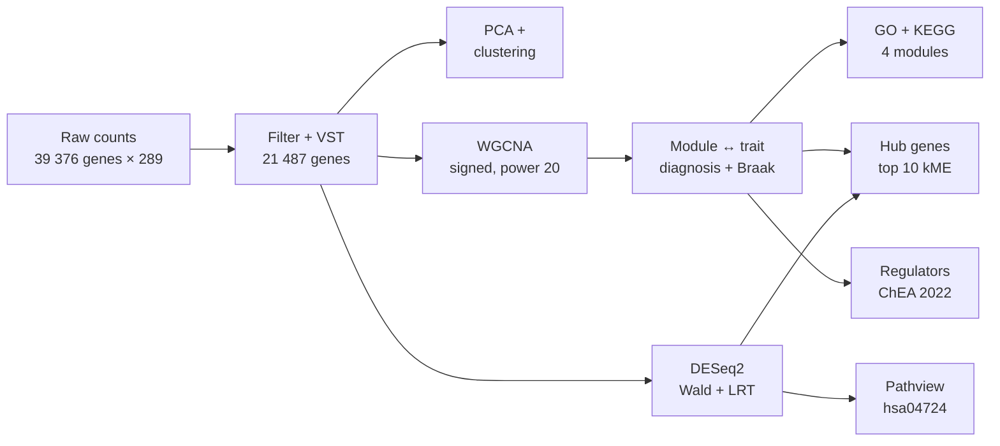

# 📘 Prosjektmal: BIN315 · GSE125583 · Alzheimer

> **Én fil for alt:** status, filer, plan, skriving, kilder og KI-logg.
> **Oppdatert:** fredag 27.11.2026 (etter Charlenes commits kl. 11:36)
> **Rapporten** skrives i `Project.Rmd`. Denne malen endrer **ingenting** der.
> **Den andre filen** i `workbook/` er `Project_forklart.html`: rapporten med forklaringer.

**Innhold**
0. [Status nå](#0--status-nå)
1. [Filoversikt](#1--filoversikt)
2. [Analysen vi har gjort](#2--analysen-vi-har-gjort)
3. [Plan til levering](#3--plan-til-levering)
4. [Skriveplan](#4--skriveplan)
5. [References](#5--references-ferdig-liste)
6. [Presentasjon 4.12](#6--presentasjon-412)
7. [Før innlevering + KI-logg](#7--før-innlevering--ki-logg)
8. [Hjelp på forespørsel](#8--hjelp-på-forespørsel)
9. [Vedlegg: kort teori](#9--vedlegg-kort-teori)

---

# 0 · Status nå

**Leveres:** rapport ~1500 ord (RMarkdown → HTML, `code_folding: hide`) **tirsdag 1.12** · presentasjon 10 min **fredag 4.12**

```
 Del            Status                                     Ord nå / mål
 ─────────────  ─────────────────────────────────────────  ────────────
 Abstract       ░░░░░░░░░░  bare et notat                     0 / 150
 Introduction   ░░░░░░░░░░  bare et notat                     0 / 300
 Methods        ██████████  ferdig (engelsk + norsk versjon)  475 / 300 ⚠️
 Results        ████████░░  Charlenes tekst (norsk)           380 / 400
 Discussion     ░░░░░░░░░░  tom                               0 / 350
 References     ░░░░░░░░░░  tom (listen er klar i del 5)       –
```

⚠️ **Methods er ~175 ord for lang.** Slett `## Analysis overview`-listen (den gjentar teksten), og kort ned litt.

## 🚨 Ting vi fant i `Project.Rmd` (ikke fikset, det er deres fil)

| # | Hva | Linje | Hvorfor viktig | Slik fikser dere |
|---|---|---|---|---|
| 1 | **Rest av Git-konflikt:** `>>>>>>> 0b3a58e…` | 66 | vises som **rar tekst** i rapporten | slett hele linjen |
| 2 | `#koding` | 60 | et notat som havner i rapporten | slett linjen |
| 3 | **To `# Results`** + norsk «Metode:» etter Hub genes | 1047–1065 | innholdsfortegnelsen får **to** Results, og Methods står **to ganger** | velg språk, flytt teksten (se del 3) |
| 4 | Results-tekst for **GO, KEGG, DESeq2, hub, regulatorer** finnes bare i `Project_shell.Rmd` | shell 62–69 | mangler i hovedrapporten | flytt over til `Project.Rmd` |
| 5 | **Canvas-tekst** over Abstract | 19–27 | oppgaveteksten skal ikke leveres | slett |
| 6 | Notater: «forteller hva vi gjorde…», «150 ord…», «~300 ord. Plan…», «Unsupervised learning…» | 30, 33–34, 42 | notater, ikke rapporttekst | slett når delen er skrevet |
| 7 | `<!-- TODO -->` **hvorfor** pink, brown, magenta og green? | 143 | må begrunnes i Methods | spør Charlene |
| 8 | **Software** mangler R-versjon | 151 | reproduserbarhet | `R.version.string` på maskinen som knitter |
| 9 | Tom chunk `{r}` | 1043 | ufarlig | kan slettes |
| 10 | `date: "2026-10-27"`, `title: "Project"` | 3–4 | ser uferdig ut | ekte tittel + leveringsdato |

## 🎨 Viktigst av alt: to maskiner = to sett moduler

WGCNA gir **ulike moduler** på deres to Mac-er (ulike pakkeversjoner).

| | Kachinas knit (26.11) | Charlenes knit (tekst + `figures/`) |
|---|---|---|
| Antall moduler | **22** + 3 240 grå gener | **20** + 3 216 grå gener |
| Myelin-modulen | **pink** | **magenta** |
| Ribosom-modulen | **magenta** | **green** |
| Synapse-modulen | **brown** | **brown** ✅ |
| Kromatin/nukleosom | (ingen av de 4) | **pink** |

➡️ **Charlenes Results-tekst stemmer bare med Charlenes knit.**
➡️ DESeq2-tallene (**8 473** og **3 205** gener) er **like** på begge maskinene. De avhenger ikke av WGCNA.

**Sjekket 27.11:** koden for filter, VST og WGCNA er **lik** i alle commits siden 19.11, og datafilene er **like** (md5). Forskjellen kommer altså fra **maskinen**: R-versjon, pakkeversjoner og prosessor. Kachina har R 4.3.1, WGCNA 1.73 og Apple arm64.

### ✅ Løsning: lagre modulene i en fil, så knitter **begge** likt

> 🍪 **Analogi:** i stedet for at begge baker kaken selv (og får litt ulike kaker), baker Charlene **én** kake og legger den i kjøleskapet. Alle som knitter, tar kaken fra kjøleskapet.

```
 Charlenes Mac                          GitHub                    Kachinas Mac
 ┌──────────────────────┐                ┌────────────────────┐    ┌────────────────────┐
 │ WGCNA kjører én gang │──saveRDS──►    │ data/              │──► │ readRDS            │
 │ → 20 moduler         │   push         │ wgcna_modules.rds  │pull│ → SAMME 20 moduler │
 └──────────────────────┘                └────────────────────┘    └────────────────────┘
```

**WGCNA-chunken etter endringen** (all koden til Charlene er med, den er bare pakket inn i `if/else`):

```r
# Modulene lagres i en fil, slik at alle maskiner får de samme modulene
modules.file <- "data/wgcna_modules.rds"

if (file.exists(modules.file)) {
  # Bruk modulene som allerede er beregnet (på Charlenes maskin)
  modules <- readRDS(modules.file)
} else {
  # Gjør analysen mer reproduserbar
  set.seed(3)

  # Finn genmoduler
  modules <- WGCNA::blockwiseModules(
    datExpr,
    power = softPower,
    networkType = "signed",
    TOMType = "signed",
    minModuleSize = 40,
    mergeCutHeight = 0.25,
    maxBlockSize = 5000,
    numericLabels = FALSE,
    randomSeed = 3,
    verbose = 3
  )

  # Lagre modulene til neste knit
  saveRDS(modules, modules.file)
}

# Antall gener i hver modul
table(modules$colors)

# Hent modulenes oppsummerte uttrykksprofiler
MEs <- modules$MEs
```

**Rekkefølge (viktig):**

| Steg | Hvem | Gjør | ✅ Ferdig når |
|---|---|---|---|
| 1 | K eller C | Lim inn chunken over i `Project.Rmd` → Commit → Push | chunken er på GitHub |
| 2 | **C** | Pull → **Knit** (WGCNA kjører én gang og lager fila) | `table(modules$colors)` viser **grey 3216** og 20 andre farger |
| 3 | **C** | Commit + Push `data/wgcna_modules.rds` (~1 MB) | fila er på GitHub |
| 4 | **K** | Pull → **slett mappen `Project_cache/`** → Knit | din knit viser **grey 3216**, og pink/magenta/green betyr det samme som i Charlenes tekst |

⚠️ **Kachina: ikke knit mellom steg 1 og 4.** Da lager *din* maskin fila (22 moduler). Skjer det: slett `data/wgcna_modules.rds`, **ikke** commit den, og vent på Charlenes.
⚠️ **Hvorfor slette `Project_cache/`?** GO, KEGG, regulatorer og pathview er lagret i cachen med **de gamle** modulene. knitr ser ikke at modulene er byttet, så cachen må tømmes **én gang**.
💡 **Til Methods/Discussion:** dette er et godt reproduserbarhets-poeng. WGCNA ga ulike moduler på to maskiner, og derfor ble modulene lagret i én fil.

⚠️ **Doble figurer:** Results har nå både figurer **fra koden** og Charlenes **faste bilder** (`figures/*.png`). Bruk **én** av dem per figur, ellers kan farger og tall krangle.

## 🤝 Bestem sammen i dag (fre 27.11, lab-hjelp)

```
☐ 1. Rapportfil = Project.Rmd           (anbefalt: ja, koden må være med)
☐ 2. Språk = engelsk eller norsk?        (Methods finnes på begge, Results bare på norsk)
☐ 3. Modul-fila (wgcna_modules.rds)?    (anbefalt: ja, da kan BEGGE knitte likt)
☐ 4. Kode-figurer eller faste bilder?    (anbefalt: kode-figurer, de stemmer da hos begge)
☐ 5. Hvem skriver hva? (forslag i del 3)
```

---

# 1 · Filoversikt

**Tegnforklaring:** ⭐ hovedfil · ✅ trengs · 🔄 lages automatisk ved knit · 📎 kilde/oppgave · 🟡 kan slettes **etter avtale** · ❌ søppel

```
PROSJEKT/
├── Project.Rmd ................. ⭐ RAPPORTEN: tekst + all kode
├── Project.html ................ ⭐ det dere leverer (knit av Project.Rmd)
├── PROSJEKT.Rproj .............. ✅ RStudio-prosjektet (åpne denne først)
├── .gitignore .................. ✅ hva Git skal hoppe over
│
├── data/
│   ├── GSE125583_raw_counts.tsv.gz ... ✅ gentellinger (lest av koden)
│   ├── GSE125583_traits.csv .......... ✅ prøveinfo (lest av koden)
│   ├── GSE125583_series_matrix.txt.gz  ✅ GEO-originalen som traits.csv kom fra
│   ├── wgcna_modules.rds ............. ✅ KOMMER: modulene fra Charlenes maskin (del 0)
│   └── genesets/ (ChEA, GWAS) ........ 🟡 ikke brukt (enrichR henter ChEA fra nett)
│
├── figures/
│   ├── PCA_diagnosis.png ............. 📊 Charlenes faste figurer,
│   ├── PCA_Braak-stadium.png .........    brukt i Results-teksten
│   ├── Heatmap.png ...................    (fra HENNES knit)
│   ├── GO.png ........................
│   └── hsa04724.png / .xml ........... 🔄 KEGG-kartet pathview laster ned
├── hsa04724.AD_vs_control.png ........ 🔄 pathview-figuren
├── GO_modules.png .................... 🔄 lagres av chunken «samle GO figurene»
├── Project_cache/ .................... 🔄 knit-cache (gjør knitting raskt)
├── Project_files/ .................... 🔄 figurer fra knit (cachen trenger dem)
│
├── Project_shell.Rmd / .html ......... 🟡 skallet fra 6.11, MEN har fortsatt
│                                          Charlenes Results-tekst for GO, KEGG,
│                                          DESeq2, hub og regulatorer → flytt først!
├── Project_file.Rmd .................. 🟡 eldste skall (5.11), ikke i bruk
│
├── Week9_Project.pptx ................ 📎 lærerens prosjektslides (oppgaven)
├── nihms-1608497.pdf ................. 📎 Srinivasan 2020 (artikkelen til datasettet)
├── fnagi-15-1138336.pdf .............. 📎 Ribeiro-dos-Santos 2023 (fusiform + nettverk)
│
├── .RDataTmp ......................... ❌ R-søppel, 44 MB, ligger dessverre i Git
├── .Rhistory, .DS_Store .............. ❌ søppel (Git hopper over dem)
│
└── workbook/ ......................... 📒 våre hjelpefiler (ikke en del av rapporten)
    ├── prosjektmal.md ................ ← denne filen
    └── Project_forklart.html ......... ← rapporten med forklaringer på hver chunk
```

### Hva trengs for at rapporten skal kunne knittes?

| Må finnes | Hvorfor |
|---|---|
| `Project.Rmd` | koden + teksten |
| `data/GSE125583_raw_counts.tsv.gz` + `data/GSE125583_traits.csv` | koden leser disse |
| `figures/*.png` | **bare** hvis dere beholder Charlenes faste bilder |
| internett | KEGG, pathview og enrichR henter data fra nett |

### Hva skjedde med de gamle filene i `workbook/`?

De er **slått sammen** inn i denne filen og **slettet**. De ligger fortsatt i **Git-historikken** (commit `6f3dd86`) hvis dere trenger dem.

| Gammel fil | Hva den var | Hvor innholdet er nå |
|---|---|---|
| `oppgavemal.md` (5.11) | første plan + teori | del 2 og del 9 |
| `analysis_mal.Rmd` (5.11) | kodemal med TODO-er | ikke nødvendig: koden er ferdig i `Project.Rmd` |
| `skriveplan.md` (11.11) | fakta + kilder til Intro og Methods | del 4 og del 5 |
| `analysis_alle_labber.Rmd` (18.11) | kodemal for «alle labber» | ikke nødvendig (ekstra-analysene ble ikke gjort, se del 2) |
| `stegplan_alle_labber.md` (18.11) | stegplan med datoer | del 2 (hva som ble gjort) og del 3 (ny plan) |
| `methods_utkast.md` (23.11) | stillas + utkast til Methods | teksten er limt inn i `Project.Rmd` · kildene er i del 5 |
| `Project_forklart.html` (23.11) | forklart rapport | **oppdatert** til knit-en fra 26.11 |

Gjenopprett en gammel fil (hvis dere trenger den):

```bash
git checkout 6f3dd86 -- workbook/skriveplan.md
```

---

# 2 · Analysen vi har gjort



| # | Steg | Det vi faktisk gjorde | Chunk(er) | Lab |
|---|---|---|---|---|
| 1 | Filter + VST | ≥ 10 counts i ≥ 20 % (58) av prøvene → **21 487 gener** · VST `blind = TRUE` | `filtrere data`, `normalisering` | 2 |
| 2 | Oversikt | PCA på **alle** VST-gener · clustering (Euclidean, complete) · farget etter diagnose og Braak | `PCA…`, `clustering` | 4 |
| 3 | WGCNA | **signed** · alle 21 487 gener · power **20** (R² ≥ 0,80) · `maxBlockSize = 5000` · `minModuleSize = 40` · `mergeCutHeight = 0.25` | `WGCNA prep`, `power`, `WGCNA`, `module size` | 6 |
| 4 | Modul ↔ trait | diagnose → **Pearson** · Braak 1–6 → **Spearman** · BH-FDR · `lm` + alder + kjønn · felles modell + **F-test** | `sammenhenger` → `moduler-diagnos-braak` | 6 |
| 5 | GO + KEGG | `clusterProfiler`, bakgrunn = alle nettverksgener · pink, brown, magenta, green | `genlister moduler` → `KEGG` | 3/7 |
| 6 | Regulatorer | Enrichr **ChEA 2022** (TF-mål fra ChIP-seq) | `regulatoranalyse` | 8 |
| 7 | DESeq2 | 287 prøver · `~ age + sex + braak + diagnosis` · **Wald** (AD vs kontroll) · **LRT** (Braak utover diagnose) · sjekk av MT1B | `DESeq2-…`, `kontoll gen 4490` | 3 |
| 8 | Pathview | log2FC AD vs kontroll på **glutamatergic synapse** (hsa04724) | `pathway-synapse` | 7 |
| 9 | Hub-gener | topp 10 **kME** per modul + DESeq2-FDR | `hub gener` | 6 |

### Hovedfunn (fra **Kachinas** knit, 22 moduler)

> ⚠️ Fargene er fra Kachinas knit. Hos Charlene heter de noe annet (se del 0).

- **Myelin-modulen** (pink her) følger **Braak**, men **ikke diagnose** i den felles modellen (Braak_FDR 0,011 · Diagnosis_FDR 0,99). 🌟 Dette svarer direkte på forskningsspørsmålet.
- **Brown** = synapse-gener. Sterkest **negativ** med AD. Regulatorer: SUZ12, REST, EGR1.
- **Ribosom-modulen** (magenta her) = translasjon. Regulator: MYC.
- **DESeq2:** **8 473** gener AD vs kontroll · **3 205** gener der Braak tilfører noe utover diagnose.
- **MT1B** (toppgenet for Braak) er **neppe** ekte: av/på-mønster, ikke en trapp. Nevn sjekken i Discussion.
- **Pathview:** de fleste synapse-genene er **litt lavere** i AD (små endringer).

### Planlagt, men ikke gjort (fra de gamle malene)

| Ekstra | Status | Forslag |
|---|---|---|
| Celletype-markører (B) | ❌ | **dropp**, men nevn **cellesammensetning** som begrensning |
| Resiliens på Braak IV (C) | ❌ | dropp, nevn som «future work» |
| Hub-gener fra litteraturen (D: FNDC3A, MED23, NRIP1, PKN2) | ❌ | 🟢 5 min med `%in%` hvis dere vil |
| AD-risikogener (GWAS) | ❌ | dropp |
| Random forest (lab 5) | ❌ | dropp |
| Scatter cor(Braak) mot cor(diagnose) | ❌ | dropp (heatmap + felles modell viser det samme) |

---

# 3 · Plan til levering

**Forslag til fordeling** (endre fritt): **C** = Charlene · **K** = Kachina

### Fredag 27.11 · lab-hjelp
- ☐ **Pull** før dere begynner (begge)
- ☐ Avtal punktene i «Bestem sammen» (del 0)
- ☐ **C:** forklar hvorfor pink, brown, magenta og green ble valgt → én setning i Methods
- ☐ **K eller C:** fiks problem 1, 2, 5 og 9 fra del 0 (2 min)
- ☐ **Modul-fila:** steg 1–4 i del 0 («Løsning: lagre modulene i en fil»)
- ✅ **Ferdig når:** dere er enige om språk og fil, og **begge** knitter med **grey 3216**

### Lørdag 28.11
- ☐ **C:** flytt resten av Results fra `Project_shell.Rmd` inn under riktige `##`-overskrifter i `Project.Rmd`
- ☐ **C:** slett den doble `# Results` og (hvis engelsk) den norske «Metode»-teksten
- ☐ **K:** skriv **Introduction** (fakta + kilder i del 4)
- ✅ **Ferdig når:** bare **én** `# Results`, og Intro er ~300 ord

### Søndag 29.11
- ☐ **K + C:** skriv **Discussion** (stillas i del 4)
- ☐ Kort ned **Methods** til ~300 ord
- ✅ **Ferdig når:** Discussion svarer på forskningsspørsmålet og har 3 begrensninger

### Mandag 30.11
- ☐ **Abstract** (skrives sist)
- ☐ Lim inn **References** (del 5)
- ☐ **K eller C:** endelig knit: *Session → Restart R* → *Knit* (begge får samme resultat når modul-fila er på plass)
- ☐ Sjekkliste i del 7
- ✅ **Ferdig når:** HTML uten feil, ingen `TODO`, ~1500 ord

### Tirsdag 1.12 · 📤 lever
### Onsdag 2.12 – torsdag 3.12 · slides + øving (del 6)
### Fredag 4.12 · 🎤 presentasjon

> 💡 **Git-regel:** Pull før, Push etter. **Én person** i `Project.Rmd` om gangen. Si fra: *«Jeg jobber i Results nå.»*

---

# 4 · Skriveplan

**Ordbudsjett (~1500):**

```
 Abstract 150 │██
 Intro    300 │████
 Methods  300 │████
 Results  400 │█████
 Discuss. 350 │████▌
```

## 4.1 Introduction (~300 ord, 4 avsnitt)

```
 ① AD generelt  ─►  ② Braak  ─►  ③ Fusiform gyrus  ─►  ④ Gap + spørsmål
   (bredt)                                                 (smalt)
```

🔻 **Trakt:** start **bredt** (sykdommen), slutt **smalt** (deres spørsmål).

**① Alzheimer's disease (~70 ord):** hva er AD, og hvorfor er den viktig?

| Fakta | Kilde |
|---|---|
| Irreversibel nevrodegenerativ sykdom → demens, mest hos eldre | Ribeiro-dos-Santos 2023, s. 1 |
| Kjennetegn: **β-amyloid-plakk** og **tau-floker** | Ribeiro-dos-Santos 2023, s. 1 |
| Molekylære endringer starter **lenge før** symptomene | Ribeiro-dos-Santos 2023, s. 1 |

**② Braak stage (~70 ord):** hvordan måler man hvor langt sykdommen har kommet?

| Fakta | Kilde |
|---|---|
| Tau-flokene sprer seg i et **fast mønster**, I → VI | Braak & Braak 1991 |
| Temporal cortex rammes **tidligere** enn frontal cortex | Srinivasan 2020, s. 5 |
| Frontal cortex rammes ved **Braak V–VI**, omtrent når demensen starter | Srinivasan 2020, s. 3 |

💡 **Poeng:** Braak er en **gradert** skala → mer informasjon enn bare AD/kontroll.

**③ Fusiform gyrus (~70 ord):** hvorfor akkurat denne regionen?

| Fakta | Kilde |
|---|---|
| Viktig for **ansikts- og objektgjenkjenning** | Srinivasan 2020, s. 5 · Ribeiro-dos-Santos 2023, s. 2 |
| Endret **funksjonell konnektivitet** ved mild kognitiv svikt | Ribeiro-dos-Santos 2023, s. 2 |
| Mekanismene i fusiform gyrus er **lite utforsket** | Ribeiro-dos-Santos 2023, s. 2 |

**④ Gap + spørsmål (~90 ord)**
- **Gap:** de fleste studier sammenligner **AD mot kontroll**. Få ser på **Braak som gradert skala** i et co-expression-nettverk.
- **Metode i én setning:** WGCNA → moduler → Braak **og** diagnose → funksjon.
- **Forskningsspørsmålet** (står allerede i `Project.Rmd`).

> ⚠️ **Sekundærkilder:** står det *«(Ma et al. 2020)»* i Ribeiro-dos-Santos, har **de** lest Ma, ikke dere. Skriv *«as reviewed in Ribeiro-dos-Santos et al. 2023»*, eller les originalen.

**Setningsstartere:**
- *"Alzheimer's disease (AD) is …"*
- *"Disease progression can be described by Braak stage, which …"*
- *"The fusiform gyrus is …, but …"*
- *"Here, we asked whether …"*

## 4.2 Methods (ferdig, bare kort ned)

```
☐ Velg språk: engelsk (linje 55–151) ELLER norsk (linje 1047–1051)
☐ Slett ## Analysis overview-listen (den gjentar teksten)
☐ Fyll inn: hvorfor de 4 modulene (TODO linje 143)
☐ Fyll inn: R-versjon under Software
☐ Ingen resultater i Methods (sjekk at det ikke står antall moduler der)
```

## 4.3 Results (Charlenes tekst finnes, flytt + sjekk)

| `##` i `Project.Rmd` | Tekst finnes? | Hvor | Figur |
|---|---|---|---|
| Overview | ✅ PCA | `Project.Rmd` 1058 | PCA (kode eller `figures/`) |
| Co-expression modules | ✅ (20 moduler) | `Project.Rmd` 1062 | – |
| Module–trait relationships | ✅ | `Project.Rmd` 1062–1064 | heatmap |
| Functional enrichment | ✅ GO + KEGG | **shell** 63–65 | GO-figur |
| Differential expression | ✅ | **shell** 67 | – |
| Pathway analysis | ✅ (én setning) | **shell** 65 | pathview |
| Hub genes | ✅ | **shell** 67 | tabell |
| (Regulatorer) | ✅ | **shell** 69 | – |

**Regler for Results:**
- Bare **funn**, ingen tolkning (det er Discussion).
- Hver figur nevnes i teksten: *«(Figure 3)»*.
- Tallene må komme fra **samme knit** som figurene.

## 4.4 Discussion (~350 ord, 4 avsnitt): stillas

> 💡 Dere skriver teksten. Her er **hva** hvert avsnitt skal svare på.

**① Hovedsvar (~80 ord):** svar på forskningsspørsmålet i 2–3 setninger.
- Er Braak-modulene **de samme** som diagnose-modulene? (ujustert: nesten ja · felles modell: noen skilles ut)
- Hvilken modul følger **Braak, men ikke diagnose**? Hvilken funksjon har den (myelin)?
- *"Most modules associated with Braak stage were also associated with diagnosis, but …"*

**② Hva betyr funnene? (~100 ord):** koble til biologi og litteratur.
- **Synapse-modulen** går ned → passer med tap av synapser i AD.
- **Myelin-modulen** følger tau-patologien → oligodendrocytter/myelin påvirkes?
- Sammenlign med **Srinivasan 2020** (samme datasett) og **Ribeiro-dos-Santos 2023** (fusiform + nettverk).
- *"This is consistent with …"* · *"In contrast to …"*
- ⚠️ Finn **egne kilder** for myelin og synapser i AD. Ikke bruk kilder dere ikke har lest.

**③ Begrensninger (~120 ord):** velg 3–4.

| Begrensning | Hvorfor det betyr noe |
|---|---|
| **Bulk RNA-seq → cellesammensetning** | en modul som går ned kan bety **færre celler** (f.eks. nevroner dør), ikke at hver celle endrer seg |
| **Braak og diagnose overlapper** | kontroller finnes bare på Braak I–IV, AD mest på IV–VI → vanskelig å skille |
| Braak I har bare **4 prøver** | usikre estimater for det stadiet |
| **Tverrsnitt** (én prøve per person, etter døden) | viser sammenheng, ikke **årsak** eller utvikling over tid |
| **WGCNA er ikke helt reproduserbar** | ulike moduler på to maskiner (22 vs 20) |
| ChEA-målene er ofte fra **ikke-hjerneceller** | regulatorene er hypoteser |
| **MT1B**-toppfunnet var et av/på-mønster | viser at enkeltfunn må sjekkes |

**④ Konklusjon + videre (~50 ord)**
- Én setning: hva lærte vi?
- Én setning «future work»: f.eks. **single-cell** data eller resiliens-gruppen på Braak IV.

## 4.5 Abstract (~150 ord, skrives **sist**)

```
 1 setning   bakgrunn + spørsmål
 1 setning   data (GSE125583, 289 prøver, fusiform gyrus)
 1 setning   metode (WGCNA, module–trait, GO/KEGG, DESeq2)
 2 setninger hovedfunn (med tall)
 1 setning   betydning
```

---

# 5 · References (ferdig liste)

> Lim inn under `# References` i `Project.Rmd`. **Sjekk hver referanse mot kilden** før levering.

```markdown
1. Benjamini Y, Hochberg Y. Controlling the false discovery rate: a practical and powerful approach to multiple testing. *J R Stat Soc Series B*. 1995;57(1):289–300.
2. Braak H, Braak E. Neuropathological stageing of Alzheimer-related changes. *Acta Neuropathol*. 1991;82(4):239–259.
3. Kuleshov MV, Jones MR, Rouillard AD, et al. Enrichr: a comprehensive gene set enrichment analysis web server 2016 update. *Nucleic Acids Res*. 2016;44(W1):W90–W97.
4. Langfelder P, Horvath S. WGCNA: an R package for weighted correlation network analysis. *BMC Bioinformatics*. 2008;9:559.
5. Love MI, Huber W, Anders S. Moderated estimation of fold change and dispersion for RNA-seq data with DESeq2. *Genome Biol*. 2014;15(12):550.
6. Luo W, Brouwer C. Pathview: an R/Bioconductor package for pathway-based data integration and visualization. *Bioinformatics*. 2013;29(14):1830–1831.
7. Ribeiro-dos-Santos Â, de Brito LM, de Araújo GS. The fusiform gyrus exhibits differential gene-gene co-expression in Alzheimer's disease. *Front Aging Neurosci*. 2023;15:1138336.
8. Srinivasan K, Friedman BA, Etxeberria A, et al. Alzheimer's patient microglia exhibit enhanced aging and unique transcriptional activation. *Cell Rep*. 2020;31(13):107843.
9. Xu S, Hu E, Cai Y, et al. Using clusterProfiler to characterize multiomics data. *Nat Protoc*. 2024;19(11):3292–3320.
10. Gene Expression Omnibus (GEO), accession GSE125583. https://www.ncbi.nlm.nih.gov/geo/query/acc.cgi?acc=GSE125583
```

| Kilde | Brukes i |
|---|---|
| Srinivasan 2020 | Intro (Braak, fusiform) + Methods (datasettet) |
| Ribeiro-dos-Santos 2023 | Intro (AD, fusiform) + Discussion |
| Braak & Braak 1991 | Intro (Braak) |
| Love 2014 · Langfelder 2008 · Xu 2024 · Kuleshov 2016 · Luo 2013 | Methods (pakkene) |
| Benjamini & Hochberg 1995 | Methods (FDR) |

> 💡 Nye kilder fra Discussion (myelin, synapser) legges til her.

---

# 6 · Presentasjon 4.12

**10 min ≈ 8 slides** (~1 min 15 s per slide)

| # | Slide | Innhold | Figur |
|---|---|---|---|
| 1 | Tittel | tittel, navn | – |
| 2 | Spørsmål | AD → Braak → fusiform gyrus → **forskningsspørsmålet** | Braak-skjema (del 9) |
| 3 | Data + metode | 289 prøver · flytdiagrammet (del 2) | flytdiagram |
| 4 | Oversikt | PCA: Braak følger PC1, men ingen tydelig atskillelse | PCA |
| 5 | Moduler ↔ trait | heatmap · 🌟 myelin følger Braak, ikke diagnose | heatmap |
| 6 | Funksjon | GO: synapse, myelin, ribosom | GO-figur |
| 7 | Gener + pathway | DESeq2-tall · pathview · hub-gener | pathview |
| 8 | Take-home | 3 punkter + 1 begrensning | – |

```
☐ Fordel slidene (f.eks. K: 1–4, C: 5–8)
☐ Bruk figurer fra den ENDELIGE knit-en (samme farger som i rapporten)
☐ Øv høyt med klokke minst 2 ganger
☐ Forbered svar: «Hvorfor power 20?» «Hvorfor signed?» «Hvorfor disse 4 modulene?»
```

---

# 7 · Før innlevering + KI-logg

**Sjekkliste:**

```
☐ Session → Restart R → Knit uten feil
☐ Ingen konflikt-rester (<<<<<<< ======= >>>>>>>)
☐ Ingen TODO, notater eller Canvas-tekst igjen
☐ Bare ÉN av hver: # Abstract, # Introduction, # Methods, # Results, # Discussion, # References
☐ Ett språk i hele rapporten
☐ Tall i teksten = tall i figurene (samme knit)
☐ ~1500 ord (uten kode og figurtekst)
☐ Alle figurer nevnt i teksten
☐ References fylt inn og sjekket
☐ R-versjon under Software
☐ code_folding: hide (står allerede i YAML)
☐ Summary of Gen AI use skrevet
```

## KI-logg (utkast til «Summary of Gen AI use»)

> Skrevet på engelsk, i første person. **Sjekk og rett**: bare det som faktisk skjedde. Charlene legger til sin egen bruk.

```
Summary of Gen AI use (Claude, Anthropic)

Planning
- Used Claude to make a project plan, a step plan and a writing plan
  (word budget, which facts and sources belong in the Introduction).

Code and RStudio
- The analysis code was written by [Charlene / us].   ← fyll inn
- Claude added report headings, reordered chunks (no code changed),
  added cache = TRUE to slow chunks and a floating table of contents.
- Claude helped install missing R packages (clusterProfiler, enrichplot)
  and explained error messages.
- Claude helped us check Git merges so no code was lost.

Writing
- Claude wrote a draft of the Methods section from our code.
  We pasted it into the report and [edited it / shortened it].   ← fyll inn
- Claude compiled the reference list. We checked it against the sources.
- [Introduction / Discussion / Abstract: who wrote them, and how AI was used]   ← fyll inn

Understanding
- Claude made an explained copy of our HTML report to help us understand
  each analysis step and its output.

We are responsible for all analyses, interpretations and text in the report.
```

---

# 8 · Hjelp på forespørsel

| Skriv dette | Da får du |
|---|---|
| `sjekk teksten min` + lim inn | tilbakemelding på et avsnitt (struktur, kilder, ord) |
| `stillas <del>` | fakta + setningsstartere for en del |
| `forklar <begrep>` | enkel forklaring med figur (f.eks. `forklar F-test`) |
| `test meg` | 3 spørsmål før presentasjonen |
| `status` | ny sjekk av filer, Git og rapporten |
| `ordtelling` | antall ord per del |

---

# 9 · Vedlegg: kort teori

## Braak ≠ diagnose

```
 Braak I–II        Braak III–IV             Braak V–VI
 ┌──────────┐      ┌──────────────────┐     ┌──────────────┐
 │entorhinal│ ──►  │hippocampus +     │ ──► │hele neocortex│
 │ cortex   │      │temporallappen 📍 │     │              │
 └──────────┘      └──────────────────┘     └──────────────┘
                     ▲ fusiform gyrus
```

- **Braak stage** = hvor langt **tau-floker** har spredt seg (I–VI), målt etter døden. 🔥 Som en skogbrann som alltid sprer seg **samme vei**.
- **Diagnose** = **demens** (symptomer). Braak = **patologi** (floker).
- På **Braak IV** finnes både **31 kontroller** og **68 AD** → samme floker, ulikt utfall.

## Metodene i én tabell

| Begrep | Enkelt sagt | Analogi |
|---|---|---|
| **VST** | gjør tellinger log-lignende med jevn varians | regn om alle priser til samme valuta |
| **PCA** | koker 21 487 gener ned til noen få akser | ta bilde fra vinkelen som viser mest |
| **Hierarchical clustering** | slår sammen de mest like prøvene, steg for steg | et slektstre for prøver |
| **WGCNA module** | gener som går opp og ned **sammen** | en stemmegruppe i et kor |
| **Soft power (20)** | demper svake korrelasjoner | skru opp kontrasten på et bilde |
| **Signed network** | bare gener som går i **samme retning** kobles | |
| **Eigengene (ME)** | modulens gjennomsnittsprofil (1. PC) | korets melodi |
| **kME / hub gene** | hvor tett et gen følger modulen / genet som følger tettest | forsangeren |
| **Pearson / Spearman** | lineær sammenheng / sammenheng i **rekkefølge** (Braak er rangert) | |
| **F-test (felles modell)** | fjern Braak (eller diagnose): blir modellen dårligere? | fjern én ingrediens: smaker kaken annerledes? |
| **BH-FDR** | korrigerer p-verdier for mange tester | |
| **GO / KEGG enrichment** | er en funksjon **overrepresentert** i modulen? | trekke kuler fra en urne |
| **DESeq2 Wald** | er genet ulikt mellom AD og kontroll? | |
| **DESeq2 LRT** | tilfører Braak noe **utover** diagnose? | |
| **log2FC** | 1 = dobbelt · −1 = halvparten · 0,4 ≈ 30 % mer | |
| **Pathview** | farger genene på et KEGG-kart etter log2FC | et kart med røde og grønne gater |
| **ChEA** | transkripsjonsfaktorer som binder mange gener i modulen (ChIP-seq) | |

## 🍪 Celletype-fella (til Discussion)

I AD **dør nevroner**, og **mikroglia øker**.
En «nevron-modul som går ned» kan bety **færre nevroner**, ikke at hvert nevron endrer seg.
Bulk RNA-seq kan ikke skille disse to.
